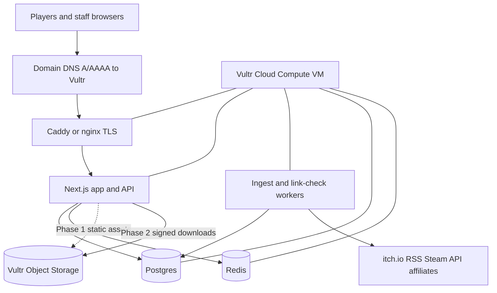

# Website and app architecture

**Date:** 14 October 2026  
**Status:** target architecture for implementation. Aligns with `docs/gaps.md`, `docs/how_we_get_links.md`, `docs/considerations.md`, `docs/revenue_streams.md`, and `docs/design-and-mascot.md`.  
**Principle:** Phase 1 distributes **links only**. Phase 2 adds **licensed builds** via Object Storage and a sideloaded Android store app. Nothing in Phase 1 stores game binaries.

**Hosting decision:** **Vultr** is the initial production platform for compute, TLS termination, and (when needed) Object Storage. The link catalog runs on a single Vultr Cloud Compute instance until traffic or compliance needs force a split. UI page layout is specified in `docs/design-layout.md`.

---

## System context

```text
                    ┌─────────────────────────────────────────┐
                    │           External platforms             │
                    │  Steam, itch.io, Nutaku, dev sites, …   │
                    └──────────────────▲──────────────────────┘
                                       │ outbound clicks (affiliate or plain)
┌──────────────┐   HTTPS    ┌──────────┴──────────┐   jobs    ┌─────────────┐
│   Browsers   │◄──────────►│  Catalog (Vultr)    │◄─────────►│ Feed ingest │
│  (18+ gate)  │            │  web + API + admin    │           │  (daily)    │
└──────────────┘            └──────────┬──────────┘           └──────▲──────┘
                                       │                              │
                                       │ JSON (Phase 2+)              │ RSS / Steam API /
┌──────────────┐   HTTPS               │                              │ affiliate exports
│ Android store│◄──────────────────────┤                              │
│  app (APK)   │                       │                              │
└──────────────┘                       ▼                              │
                            ┌─────────────────────┐         itch.io new.xml
                            │ Postgres + Redis    │         Steam GetAppList
                            │ (listings, queue)   │         developer form
                            └─────────────────────┘

Phase 2 only:
                            ┌─────────────────────┐
                            │ Vultr Object Storage │
                            │ signed build objects │
                            └─────────────────────┘
```

Players discover games on the **website** first. The **Android app** is the trust layer for installs and updates once the store hosts builds. Until then, the app is optional; the site is the product.

---

## Phased delivery

| Phase | User-facing | Backend | Storage | Money |
| --- | --- | --- | --- | --- |
| **1 — Link catalog** | Marketing pages, browse/search, game detail with outbound CTA, age gate, legal pages | Ingest jobs, review admin, public read API | Postgres; Redis for sessions/rate limits | Affiliate links, adult display ads, sponsored rows |
| **2 — Hosted builds** | Same catalog + “Download” on licensed titles; Android store APK | Upload pipeline, license records, signed download URLs | Object Storage for builds; hash per build | Per-download commission via adult processor |
| **3 — Live ops (later)** | Wallet, in-game currency, featuring | Payment webhooks, fraud, SDK docs | Same + ledger | Platform wallet (Nutaku-shaped) |

This document specifies Phase 1 in detail and names Phase 2 boundaries so the Phase 1 stack does not need a rewrite.

---

## Phase 1: logical components

### 1. Public web application

**Responsibilities**

- Age assurance **before** any explicit thumbnail or copy (vendor integration; not a self-attestation checkbox alone — see `docs/gaps.md`).
- Browse: new, featured (including labeled sponsorships), tags (minimal v1: platform + “has affiliate”).
- Game detail: title, platforms, outbound primary button (`official_url` or `affiliate_url` when present), affiliate disclosure, artwork with documented source.
- Developer submission form (creates a **candidate**, not a public row).
- Static legal: terms, privacy, affiliate disclosure, copyright/DMCA contact.

**Non-goals in Phase 1**

- No hotlinked screenshots from merchant CDNs as the primary art strategy.
- No iframe embed of Nutaku/Steam checkout.
- No user accounts required to browse (optional email capture post-gate for newsletter — later).

**Suggested stack (one team, one deploy unit)**

- **Next.js** (App Router) on Node 20+: SSR/ISR for SEO on catalog pages, Route Handlers for BFF-style API if you want to hide internal URLs.
- **Tailwind CSS** + design tokens from `docs/design-and-mascot.md` (`#14061C` background, `#C026D3` primary, etc.).
- **shadcn/ui** for forms, dialogs, data tables in admin.

Alternative: separate **Vite + React** marketing site and small **Hono/Fastify** API. Next.js is preferred when SEO and one repo matter for a catalog.

### 2. Admin / review console

**Responsibilities**

- Queue of **candidates** from feeds and developer form.
- Approve → promote to **public listing** with content-line checklist (`docs/considerations.md`).
- Reject with reason (internal).
- Edit public rows: tags, URLs, artwork source, sponsorship flag.
- Weekly dead-link report (from link checker job).

**Access**

- Staff-only, behind VPN or SSO + MFA; not on the public age-gated path.
- Role: `reviewer`, `editor`, `admin` (v1 can be single role).

### 3. Ingest service (worker)

**Responsibilities**

- Daily (or hourly) pull from configured sources — see `docs/how_we_get_links.md`.
- Write **candidates only**; never auto-publish.
- Respect robots.txt and rate limits; identifiable User-Agent; stop on disallow.
- Dedupe: `(source, external_id)`.

**Sources (order)**

1. itch.io `https://itch.io/feed/new.xml`
2. Steam `IStoreService/GetAppList` with `if_modified_since`, then filter via store details for adult-only sexual content descriptor
3. Affiliate program exports (per network, post-approval)
4. Developer form POST

**Implementation shape**

- Separate process from web (cron on same VM, or systemd timer, or lightweight queue consumer).
- Language: TypeScript (shared types with web) or Python; match the main app language.
- Failures: log per source; do not block other sources.

### 4. Link health job

- Weekly HTTP HEAD/GET on `official_url` and `affiliate_url`.
- Mark `link_status = broken`; hide from public list or show “link unavailable” in admin until fixed.

### 5. Age assurance

- Integrate a **third-party age verification vendor** that meets UK Online Safety Act expectations for pornography services (highly effective age assurance).
- Flow: landing → vendor widget/session → signed cookie/session flag → catalog routes allowed.
- Store: verification method, timestamp, session id (minimal PII per vendor contract); privacy notice must describe this.
- Vesper storefront artwork on gate UI per brand doc.

### 6. Analytics and revenue hooks

- Outbound click events: `listing_id`, `url_type` (`official` | `affiliate` | `sponsored`), timestamp, coarse geo if allowed.
- Affiliate URLs never stripped of tracking params.
- Ad network slots: layout placeholders after gate; no AdSense (`docs/revenue_streams.md`).

---

## Phase 1: data model

### Candidate (pre-public)

```text
id
source                 -- itch | steam | affiliate_export | developer_form
external_id            -- stable id from source
title
outbound_url           -- from feed or form
first_seen_at
raw_flags              -- json: steam descriptors, itch categories, etc.
review_status          -- pending | approved | rejected
reviewed_at
reviewed_by
reject_reason          -- internal
```

### Public listing

```text
id
slug                   -- url-safe, unique
title
platforms              -- enum[]: windows, mac, linux, android, browser
tags                   -- controlled vocabulary (expand post-v1)
official_url
affiliate_url          -- nullable
affiliate_disclosure   -- boolean / copy block
artwork_source         -- affiliate_kit | typographic | licensed_upload
artwork_asset_id       -- fk to our stored asset (kit file or generated card)
sponsorship            -- none | featured_until
content_line_ok        -- reviewer attestation
link_status            -- ok | broken
published_at
updated_at
```

### Artwork policy

- **Affiliate kit:** file copied into our bucket only if the program license allows local hosting of creatives; otherwise use typographic card.
- **Typographic card:** server-generated image (title + platform badges), no third-party IP.
- Never mirror a full Steam/itch screenshot gallery without permission.

### Developer submission (form)

Maps to **candidate** with `source = developer_form` plus contact email (stored encrypted or in a separate PII table with retention policy).

### Audit (Phase 2 prep)

When hosting starts, extend with `distribution_license_id`, `build_object_key`, `sha256` — not used in Phase 1.

---

## Phase 1: API surface (internal + public)

| Method | Path | Auth | Purpose |
| --- | --- | --- | --- |
| GET | `/api/v1/listings` | Public (post-gate session) | Paginated catalog |
| GET | `/api/v1/listings/:slug` | Public (post-gate) | Detail |
| POST | `/api/v1/outbound/:id/click` | Public (post-gate) | Redirect or 302 with logging |
| POST | `/api/v1/submissions` | Public (rate limited) | Developer form → candidate |
| GET | `/api/admin/candidates` | Staff | Review queue |
| PATCH | `/api/admin/candidates/:id` | Staff | Approve/reject |
| CRUD | `/api/admin/listings` | Staff | Edit public rows |

Public JSON enables a future Android client to reuse the same catalog before downloads exist.

---

## Initial hosting on Vultr

All Phase 1 and Phase 2 services below run on **Vultr** first. Revisit multi-cloud or managed PaaS only if Vultr policy, payment-adjacent compliance, or egress economics block a requirement.

### Topology (Phase 1)

```text
                         Internet
                             │
                             ▼
              ┌──────────────────────────────┐
              │  Vultr Cloud Compute (VM)     │
              │  ───────────────────────────  │
              │  Caddy or nginx :443 TLS      │
              │    ├─ Next.js (Node) :3000    │
              │    ├─ ingest worker (cron)    │
              │    └─ link-checker (weekly)   │
              │  Postgres (same VM or         │
              │    Vultr Managed DB)          │
              │  Redis (same VM, small)       │
              └──────────────────────────────┘
                             │
              optional Phase 1 ──► Vultr Object Storage
              (static assets only: typographic templates,
               affiliate creatives we may host locally)

Phase 2 adds ──► Vultr Object Storage bucket(s)
               game builds, APK, signed GET URLs
```



### Sizing and region (starting point)

| Piece | Vultr product | Phase 1 note |
| --- | --- | --- |
| Compute | Cloud Compute, 2 vCPU / 4 GB RAM (adjust after metrics) | Runs web, workers, Redis; co-locate Postgres on same VM only for staging or very early prod |
| Database | Managed PostgreSQL when prod traffic is real | Prefer managed backups and patches before launch marketing |
| Cache | Redis on VM | Sessions, rate limits, age-gate flags |
| Object Storage | Standard tier | Phase 1: optional static bucket; Phase 2: game binaries and APK |
| Firewall | Vultr firewall group | 443 public; 22 restricted to admin IPs; Postgres not public |
| DNS | Your registrar → Vultr VM IP | Staging subdomain optional (`staging.example.com`) |

Pick one **region** close to the primary audience (e.g. US East or EU Amsterdam) and record it in deploy notes. Keep staging and production in the same region until latency requirements say otherwise.

### Deploy flow on Vultr

1. Provision VM + firewall + (optional) managed Postgres.
2. Install Docker or run Node via systemd; pull release artifact from CI.
3. Caddy obtains Let’s Encrypt certs for production domain.
4. Environment variables on VM: database URL, Redis, Steam key, age vendor, affiliate secrets.
5. Cron or systemd timers for ingest and link-check on the same VM as the app (Phase 1).
6. Enable Vultr backups or scheduled DB snapshots.

**Environments:** `staging` (noindex, age vendor sandbox) and `production` on separate VMs or the same VM with separate DB — prefer separate VMs before paid traffic.

### Cost shape (order of magnitude)

Link catalog only: one small VM + domain is enough (`docs/gaps.md`). Object Storage billing matters when hosting builds (`docs/revenue_streams.md`: storage + egress per download). Keep the bucket empty until a licensed binary exists (`docs/considerations.md`).

---

## Phase 2: Android store app (architecture preview)

Build this **after** upload terms and Object Storage exist (`docs/gaps.md` order).

### Role of the app

- Signed APK distributed from the **website** (not Google Play).
- Same account system as web (email + password or magic link; token refresh).
- Catalog UI reuses `/api/v1/listings` or a thin native client.
- For **licensed** titles only: download manager → verify hash → install intent (Android package installer).
- Auto-update: check store app version + installed game versions against API.

### Client stack options

| Option | Pros | Cons |
| --- | --- | --- |
| **Kotlin + Jetpack Compose** | Best install/update integration, Play-less norm for store apps | Separate codebase from web |
| **React Native / Expo** | Shared logic with TS team | Heavier sideload/update story; still workable |
| **Capacitor WebView shell** | Fastest catalog parity with site | Weaker native download UX |

**Recommendation:** Kotlin native for the store shell and download/install path; shared OpenAPI-generated models from the same API spec as the website.

### Download path (Phase 2)

```text
Client requests download for listing_id
  → API checks age session + account + license record
  → API returns short-lived signed URL (Object Storage)
  → Client downloads, verifies sha256 from API
  → Client triggers install (user-granted unknown sources)
```

Egress pricing and share math: `docs/revenue_streams.md`.

### App icon and launcher

Storefront Vesper bust only (`docs/design-and-mascot.md`); explicit variants never on launcher.

---

## Phase 2: hosting and developer upload (boundary)

Not built in Phase 1, but Phase 1 schema and API should not block:

- Developer account + accepted terms version + timestamp.
- Upload endpoint (multipart) → virus scan hook → hash → quarantine bucket → manual or automated compliance scan → promote to public download.
- DMCA workflow and repeat infringer policy (`docs/considerations.md`).

---

## Security and compliance cross-cutting

- **Content line** enforced at review, not by algorithm alone.
- **No scrapers** of HTML catalog pages; feeds and APIs only (`docs/how_we_get_links.md`).
- **Rate limiting** on submission form and click endpoint.
- **CSP** and strict referrer policy on admin.
- **Logging:** no full IP retention beyond analytics need; align with privacy notice.
- **Affiliate compliance:** no incentivized clicks; disclose paid links.

---

## Repository layout (when code starts)

```text
/
├── apps/
│   ├── web/                 # Next.js public site + route handlers
│   └── admin/               # optional: separate admin app or /admin routes
├── packages/
│   ├── db/                  # schema, migrations (Drizzle or Prisma)
│   ├── ingest/              # feed workers
│   └── shared/              # types, content-line constants
├── workers/
│   └── link-checker/
├── docs/                    # existing product docs
└── infra/                   # docker-compose for local dev, deploy notes
```

Monorepo optional; a single Next.js app with `src/workers` is fine until ingest complexity grows.

---

## Open decisions (track in issues)

1. **Public product name** (repo name is working title).
2. **Age verification vendor** (shortlist + legal sign-off).
3. **Tag vocabulary v1** (minimum facets for browse).
4. **Affiliate networks** to apply to first (Nutaku shape documented; others TBD).
5. **Monorepo vs single app** once implementation starts.

---

## Implementation order

1. Postgres schema: candidate + listing + click events.
2. Public site shell: age gate integration stub, legal pages, empty catalog.
3. Admin review UI + promote candidate → listing.
4. itch.io ingest job → queue populates.
5. Typographic artwork generator + listing detail + outbound click logging.
6. Steam ingest after API key.
7. Developer form.
8. Staging on Vultr; production domain + TLS.
9. Affiliate exports and ad slots when accounts exist.
10. Android app spike only after first licensed build is ready for Object Storage.

This sequence matches “catalog people trust” before mascot art, wallet, or APK (`docs/gaps.md`).
