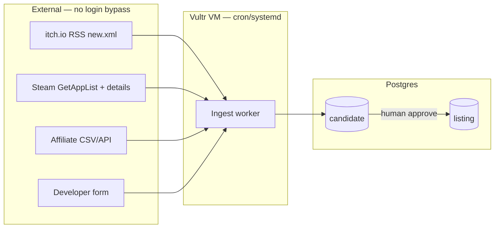

# Database and ingest (feeds, not scrapers)

**Date:** 14 October 2026  
**Status:** specification for implementation.  
**Related:** `docs/how_we_get_links.md`, `docs/architecture.md`, `docs/considerations.md`.

---

## Terminology

| Term we use | Meaning |
| --- | --- |
| **Ingest worker** | Scheduled job that reads **official feeds/APIs** and writes **candidates** |
| **Crawler / scraper** | HTML page parsing — **out of scope** for v1 (policy, breakage, rights) |

We do **not** crawl Steam store HTML, Nutaku pages, or forum mirrors. We pull **RSS**, **Steam Web API**, **affiliate exports**, and **developer form** posts.

---

## Database (Postgres)

Runs on Vultr in production (managed Postgres or co-located). **Local dev** uses Docker Compose with the same schema — no Vultr account required to build or test ingest.

### Core tables

```text
ingest_source          -- config: name, enabled, cursor, last_run_at, last_error
candidate              -- pre-public rows from any source (review queue)
listing                -- public catalog (approved)
listing_click          -- outbound analytics
ingest_run             -- optional audit log per job execution
developer_submission   -- form PII, links to candidate
```

### `candidate` (review queue)

| Column | Type | Notes |
| --- | --- | --- |
| `id` | uuid | PK |
| `source` | enum | `itch`, `steam`, `affiliate_export`, `developer_form` |
| `external_id` | text | itch game id, Steam app id, affiliate sku, etc. |
| `title` | text | from feed |
| `outbound_url` | text | official page URL |
| `first_seen_at` | timestamptz | |
| `raw_payload` | jsonb | full feed/API snippet for reviewers |
| `review_status` | enum | `pending`, `approved`, `rejected` |
| `reviewed_at` | timestamptz | |
| `reviewed_by` | text | staff id |
| `reject_reason` | text | internal |

**Unique:** `(source, external_id)` — dedupe.

### `listing` (public)

Extends approved candidate fields plus:

| Column | Type | Notes |
| --- | --- | --- |
| `slug` | text | unique URL |
| `platforms` | text[] | `windows`, `browser`, `android`, … |
| `official_url` | text | |
| `affiliate_url` | text | nullable |
| `artwork_source` | enum | `typographic`, `affiliate_kit`, `licensed_upload` |
| `sponsorship` | jsonb | `{ "type": "featured", "until": "…" }` or null |
| `link_status` | enum | `ok`, `broken` |
| `published_at` | timestamptz | |
| `chart_rank` | int | nullable — **editorial / affiliate “top”** until real revenue data exists |
| `chart_bucket` | text | nullable — `top_grossing`, `new`, … for home rails |

**Top grossing rail (UI):** v1 ranks come from **manual curation**, **affiliate program “top” exports**, or **outbound click velocity** computed in our DB — not from scraping Nutaku’s charts.

### `ingest_source` (cursor state)

| Column | Example |
| --- | --- |
| `name` | `itch_new_xml` |
| `cursor` | jsonb: `{ "last_guid": "…" }` or `{ "last_modified_since": 1730000000 }` |
| `schedule` | cron expression |
| `enabled` | boolean |

### `listing_click` (for “popular” later)

`listing_id`, `url_type`, `created_at`, optional coarse `country` — aggregate for “Popular now” without third-party charts.

---

## Ingest pipeline



### Job 1: itch.io (`itch_new_xml`)

- **GET** `https://itch.io/feed/new.xml` (public RSS).
- Parse `item` → `title`, `link`, `guid`, `pubDate`.
- `INSERT … ON CONFLICT (source, external_id) DO NOTHING` into `candidate`.
- Rate: once per day (or every 6h); polite `User-Agent` identifying the catalog.
- **No** HTML scrape of project pages.

### Job 2: Steam (`steam_app_delta`)

- **Requires:** `STEAM_WEB_API_KEY` (env secret — you create this in Steamworks, not Vultr).
- Call `IStoreService/GetAppList` with `if_modified_since` from `ingest_source.cursor`.
- For each new/changed app id, fetch store details (descriptor for adult-only sexual content).
- Only apps with the adult descriptor → `candidate` with `raw_payload` flags.
- Second pass still needs **human review** (`docs/how_we_get_links.md`).

### Job 3: Affiliate export (`affiliate_*`)

- After program approval: read dashboard **CSV/JSON export** URL or file drop (per network).
- Map to `candidate` or directly update `listing.affiliate_url` for existing rows.
- **No** scraping `nutaku.net` HTML.

### Job 4: Developer form

- HTTP POST from site → `developer_submission` + `candidate` (`source = developer_form`).

### Job 5: Link health (weekly)

- HEAD/GET `official_url` / `affiliate_url` on `listing`.
- Set `link_status = broken` on repeated failures.

### Review → publish

Staff UI: approve candidate → create `listing`, assign `slug`, platforms, artwork policy, optional `chart_rank` for **Top grossing** rail.

---

## What runs where

| Environment | Postgres | Ingest jobs | Needs Vultr? |
| --- | --- | --- | --- |
| **This repo / your laptop** | Docker Compose | `npm run ingest` manually | **No** |
| **Cursor Cloud Agent VM** | Docker Compose | same — can hit public RSS/API | **No** |
| **Staging / production** | Vultr managed or VM | cron on Vultr VM | **Yes**, when you deploy |

---

## Do you need Vultr access now?

**No — not for design, schema, app code, or ingest development.**

| Task | Vultr access |
| --- | --- |
| Docs, UI wireframes, Next.js scaffold | Not needed |
| Postgres schema + migrations | Local Docker |
| itch.io ingest (public RSS) | Runs from dev machine or Cloud Agent |
| Steam ingest | Needs **Steam Web API key** only |
| Production domain, TLS, cron 24/7 | **Vultr** (or CI deploy to Vultr) when you go live |

**What to share later (not now unless you want staging today):**

- Vultr API token or SSH to a VM — for **deploy**, firewall, managed DB.
- Domain DNS pointed at the VM.
- Secrets in Vultr env / vault: `DATABASE_URL`, `STEAM_WEB_API_KEY`, age vendor keys, affiliate keys.

**We are not on your Vultr VM today.** Work happens in this git repo and the Cloud Agent environment until you provision Vultr and we add `infra/` deploy scripts (or you run `docker compose up` locally).

---

## Secrets checklist (when ready)

1. `DATABASE_URL` — local first, then Vultr Postgres URL.
2. `STEAM_WEB_API_KEY` — [Steamworks](https://partner.steamgames.com/doc/webapi/IStoreService).
3. Affiliate credentials — per network dashboard (after approval).
4. Age verification vendor — sandbox + production keys.
5. Optional: Vultr Object Storage keys — **Phase 2** only.

---

## Implementation order

1. Docker Compose: Postgres + Redis.
2. Migrations: `candidate`, `listing`, `ingest_source`, `listing_click`.
3. CLI: `ingest itch` (single run, logs counts).
4. Admin: candidate queue + approve.
5. Steam job after API key exists.
6. Deploy worker + web to Vultr when catalog is ready to be public.
