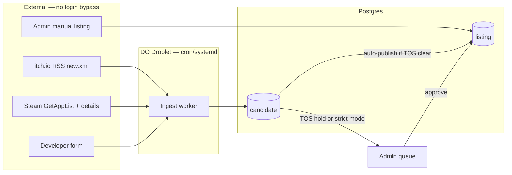

# Database and ingest (feeds, not scrapers)

**Date:** 14 October 2026  
**Status:** specification for implementation.  
**Related:** `docs/how_we_get_links.md`, `docs/architecture.md`, `docs/considerations.md`.

---

## Terminology

| Term we use | Meaning |
| --- | --- |
| **Ingest worker** | Scheduled job that reads **official feeds/APIs** and writes **candidates** |
| **Crawler / scraper** | HTML page parsing — **out of scope** for v1 (policy, breakage, rights) |

We do **not** crawl Steam store HTML, Nutaku pages, or forum mirrors. We pull **RSS**, **Steam Web API**, **developer form** posts, and **manual** curator rows (DLsite/JAST links). Affiliate program **accounts** are for tagged outbound URLs later — not a JSON file ingest in `npm run ingest`.

---

## Database (Postgres)

Runs on **DigitalOcean** in production (Managed PostgreSQL + Droplet workers). **Local dev** uses **PGlite** (`data/catalog/`) with the same Drizzle schema — run `npm run ingest:itch`. Optional `docker-compose.yml` for Postgres. No DO account required to build or test ingest.

### Core tables

```text
ingest_source          -- config: name, enabled, cursor, last_run_at, last_error
candidate              -- pre-public rows from any source (review queue)
listing                -- public catalog (approved)
analytics_event        -- outbound_click, listing_view, page_view
ingest_run             -- optional audit log per job execution
developer_submission   -- form PII, links to candidate
```

### `candidate` (review queue)

| Column | Type | Notes |
| --- | --- | --- |
| `id` | uuid | PK |
| `source` | enum | `itch`, `steam`, `developer_form`, `manual`, … |
| `external_id` | text | itch game id, Steam app id, affiliate sku, etc. |
| `title` | text | from feed |
| `outbound_url` | text | official page URL |
| `first_seen_at` | timestamptz | |
| `raw_payload` | jsonb | full feed/API snippet for reviewers |
| `review_status` | enum | `pending`, `approved`, `rejected` |
| `reviewed_at` | timestamptz | |
| `reviewed_by` | text | staff id |
| `reject_reason` | text | internal |

**Unique:** `(source, external_id)` — dedupe.

### `listing` (public)

Extends approved candidate fields plus:

| Column | Type | Notes |
| --- | --- | --- |
| `slug` | text | unique URL |
| `platforms` | text[] | `windows`, `browser`, `android`, … |
| `official_url` | text | |
| `affiliate_url` | text | nullable |
| `artwork_source` | enum | `typographic`, `affiliate_kit`, `licensed_upload` |
| `sponsorship` | jsonb | `{ "type": "featured", "until": "…" }` or null |
| `link_status` | enum | `ok`, `broken` |
| `published_at` | timestamptz | |
| `chart_rank` | int | nullable — **editorial / affiliate “top”** until real revenue data exists |
| `chart_bucket` | text | nullable — `top_grossing`, `new`, … for home rails |

**Home rails (UI):** **Hottest** = outbound clicks in the last 7 days (`analytics_event`). **Trending** = listing views in the last 48 hours. Falls back to editorial `chart_rank` / publish date until traffic exists.

### `ingest_source` (cursor state)

| Column | Example |
| --- | --- |
| `name` | `itch_new_xml` |
| `cursor` | jsonb: `{ "last_guid": "…" }` or `{ "last_modified_since": 1730000000 }` |
| `schedule` | cron expression |
| `enabled` | boolean |

### `analytics_event`

`event_type` (`outbound_click`, `listing_view`, `page_view`), `listing_id`, `path`, hashed session — powers on-site rankings without third-party charts.

---

## Ingest pipeline



**CLI:** `npm run ingest` runs itch + Steam into `candidate`, then auto-publishes TOS-clear rows when enabled (default in production). Per-source: `ingest:itch`, `ingest:steam`. **Admin:** `/admin` for TOS holds and strict manual mode; `/admin/listings/new` for curated partner URLs. Policy: [tos-review-policy.md](tos-review-policy.md).

### Job 1: itch.io (`itch_new_xml`)

- **GET** `https://itch.io/feed/new.xml` (public RSS).
- Parse `item` → `title`, `link`, `guid`, `pubDate`.
- `INSERT … ON CONFLICT (source, external_id) DO NOTHING` into `candidate`.
- Default feeds: `new.xml`, `featured.xml`, `sales.xml`, plus NSFW **tag browse** URLs (`games/tag-nsfw.xml`, etc. — `scripts/lib/itch-feeds.ts`). Override with `ITCH_FEED_URLS`; append with `ITCH_EXTRA_FEED_URLS`; `ITCH_MINIMAL_FEEDS=1` for legacy single-feed behavior.
- Tags land in `tag` / `candidate_tag` (RSS title brackets, feed context, platforms, keywords). Approved listings copy to `listing_tag`.
- Rate: once per day (or every 6h); polite `User-Agent` identifying the catalog.
- **No** HTML scrape of project pages.

### Job 2: Steam (`steam_app_delta`)

Implemented in `scripts/ingest-steam.ts`.

- **Discovery:** `data/steam-search-terms.json` + `STEAM_SEARCH_TERMS` / `STEAM_SEARCH_PER_TERM` (default 50 per term). Optional `STEAM_USE_APPLIST_DELTA=1` with API key merges `GetAppList` deltas.
- **Adult filter:** descriptor **#3** by default; `STEAM_INCLUDE_SEXUAL_DESCRIPTOR=1` also accepts **#1 (Sexual Content)**.
- **Rate limits:** `STEAM_INGEST_MAX_APPS` (default 250 detail calls/run), `STEAM_DETAIL_DELAY_MS`, `ITCH_FEED_DELAY_MS`.
- Rows → `candidate` (`source = steam`), `platforms` from Steam (windows/mac/linux).
- **Auto-publish:** TOS-clear Steam rows become `listing` when `AUTO_PUBLISH=1` or `NODE_ENV=production` (see [tos-review-policy.md](tos-review-policy.md)). Set `AUTO_PUBLISH=0` or `INGEST_REQUIRE_REVIEW=1` for all-manual review.

#### Steam Web API key

Optional for production-style deltas. Register the key in Steamworks using your **production domain** (apex or `www` — no `https://`). Store the key only in **local `.env`** (gitignored) or your host’s secret/env UI. **Do not** put keys, tokens, or connection strings in this repository or in markdown docs.

### Job 3: Developer form

- `POST /api/submissions` from `/submit` → `developer_submission` + `candidate` (`source = developer_form`).

### Job 4: Manual listings

- Admin UI → `listing` directly (`source = manual`) for DLsite/JAST/etc. until exports exist.

### Job 5: Link health (weekly)

- HEAD/GET `official_url` / `affiliate_url` on `listing`.
- Set `link_status = broken` on repeated failures.

### Review → publish

Staff UI (`/admin`): approve candidate → create `listing`, assign `slug`, platforms, artwork policy. Storefront rankings prefer live `analytics_event` aggregates.

---

## What runs where

| Environment | Postgres | Ingest jobs | Needs DigitalOcean? |
| --- | --- | --- | --- |
| **This repo / your laptop** | Docker Compose | `npm run ingest` manually | **No** |
| **Cursor Cloud Agent VM** | Docker Compose | same — can hit public RSS/API | **No** |
| **Staging / production** | DO Managed PostgreSQL | cron on Droplet | **Yes**, when you deploy |

---

## Do you need DigitalOcean access now?

**No — not for design, schema, app code, or ingest development.** You already have a DO account; we only need credentials when you want a live Droplet.

| Task | DigitalOcean access |
| --- | --- |
| Docs, UI wireframes, Next.js scaffold | Not needed |
| Postgres schema + migrations | Local Docker |
| itch.io ingest (public RSS) | Runs from dev machine or Cloud Agent |
| Steam ingest | Needs **Steam Web API key** only |
| Production domain, TLS, cron 24/7 | **Droplet + Managed DB** when you go live |

**Deploy credentials** (API tokens, DB URLs, Steam key, etc.) are configured on the host or in a private password manager — **never** committed to GitHub. See [SECURITY.md](../SECURITY.md).

**We are not on your Droplet today.** Work happens in this repo and the Cloud Agent environment until you provision infrastructure and we add `infra/` deploy scripts (or you run `docker compose up` locally).

---

## Implementation order

1. Docker Compose: Postgres + Redis.
2. Migrations: `candidate`, `listing`, `ingest_source`, `listing_click`.
3. CLI: `ingest itch` (single run, logs counts).
4. Admin: candidate queue + approve.
5. Steam job after API key exists.
6. Deploy worker + web to DigitalOcean when catalog is ready to be public.
