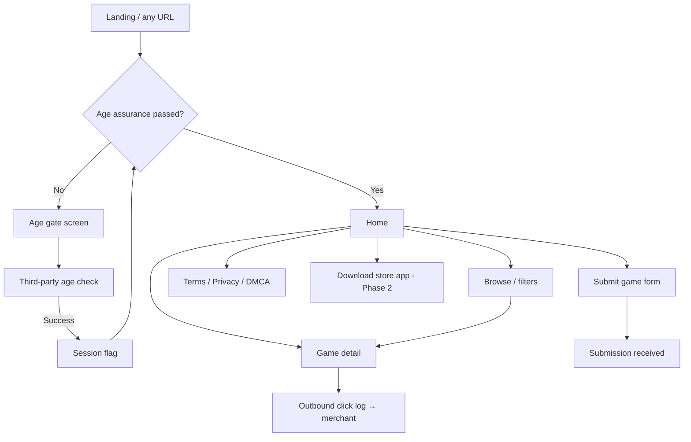

# UI layout and page structure

**Date:** 14 October 2026  
**Status:** wireframes for implementation. Visual language from `docs/design-and-mascot.md`. Hosting context in `docs/architecture.md` (Vultr Phase 1).  
**Breakpoints:** mobile `<768px`, tablet `768–1023px`, desktop `≥1024px`. Max content width `1280px`.

---

## Global chrome (post age gate)

Every catalog page shares the same shell so the store reads as one product, not a blog with game links.

```text
┌──────────────────────────────────────────────────────────────────────────────┐
│  HEADER  (#14061C bg, bottom border #241033)                                  │
│  [♥ Vesper bust]  WORDMARK ♥     New   Browse   Submit game   [♥] (later)    │
│                                                      [Search……………]  (Phase 1b)│
├──────────────────────────────────────────────────────────────────────────────┤
│  MAIN  (scroll)                                                               │
│  … page content …                                                             │
├──────────────────────────────────────────────────────────────────────────────┤
│  FOOTER  (#241033 surface)                                                    │
│  Terms · Privacy · Affiliate disclosure · DMCA · ©                           │
│  Optional: single adult ad slot (728×90 desktop / 320×50 mobile), labeled    │
└──────────────────────────────────────────────────────────────────────────────┘
```

| Zone | Behavior |
| --- | --- |
| Header | Sticky on desktop; collapses to hamburger + wordmark on mobile. Search hidden until search ships. |
| Heart control | Reserved for favorites (logged-in, later). Hover uses primary `#C026D3`. |
| Footer | Legal links always visible; affiliate disclosure page linked from any paid outbound row. |

**Pre-gate:** no header catalog links, no game thumbnails, no footer ad slot. Only age assurance + legal minimum.

---

## Screen map



---

## 1. Age gate (first visit)

No sexual content, no catalog previews. Vesper in **storefront** outfit frames the vendor flow.

### Desktop

```text
┌────────────────────────────────────────────────────────────────────────────┐
│                         full viewport #14061C                               │
│                                                                             │
│     floating geometric hearts (soft #F9A8D4, accent #FF4D8D)                │
│                                                                             │
│              ┌─────────────────────┐    ┌──────────────────────────────┐   │
│              │                     │    │  Adults only                 │   │
│              │   Vesper full-body  │    │  This catalog lists 18+ games.│   │
│              │   (storefront)      │    │                              │   │
│              │                     │    │  ┌──────────────────────────┐ │   │
│              │                     │    │  │ Age vendor widget /     │ │   │
│              │                     │    │  │ redirect (primary CTA)   │ │   │
│              └─────────────────────┘    │  └──────────────────────────┘ │   │
│                                         │  Wordmark ♥ (small)           │   │
│                                         │  Terms · Privacy (text links) │   │
│                                         └──────────────────────────────┘   │
│                                                                             │
└────────────────────────────────────────────────────────────────────────────┘
```

### Mobile

Stack: wordmark → card (copy + vendor CTA) → smaller Vesper below or as card header crop. Hearts reduced to avoid clutter.

**Do not** use a lone “I am 18” checkbox as the only control (`docs/gaps.md`).

---

## 2. Home

Purpose: orient new visitors — **New**, **Featured** (includes labeled sponsorships), path to **Browse**.

### Desktop

```text
┌──────────────────────────────────────────────────────────────────────────────┐
│ HEADER                                                                        │
├──────────────────────────────────────────────────────────────────────────────┤
│  HERO ROW (optional, low height)                                              │
│  One line + heart accent: “Find adult games for PC, browser, and Android.”   │
├──────────────────────────────────────────────────────────────────────────────┤
│  FEATURED  (#FF4D8D “Sponsored” pill when paid)                               │
│  ┌────────────┐ ┌────────────┐ ┌────────────┐ ┌────────────┐                 │
│  │ card       │ │ card       │ │ card       │ │ card       │  horizontal     │
│  │ surface    │ │ + Vesper   │ │            │ │            │  scroll OK      │
│  │ #241033    │ │ corner crop│ │            │ │            │  on mobile      │
│  └────────────┘ └────────────┘ └────────────┘ └────────────┘                 │
├──────────────────────────────────────────────────────────────────────────────┤
│  NEW THIS WEEK                                    [See all →]                 │
│  ┌──────┐ ┌──────┐ ┌──────┐ ┌──────┐ ┌──────┐ ┌──────┐                       │
│  │ tile │ │ tile │ │ tile │ │ tile │ │ tile │ │ tile │   6-col grid          │
│  └──────┘ └──────┘ └──────┘ └──────┘ └──────┘ └──────┘                       │
│  each tile: typographic art OR licensed thumb, title, platform icons, ♥      │
├──────────────────────────────────────────────────────────────────────────────┤
│  AD SLOT (optional, labeled “Advertisement”)                                  │
├──────────────────────────────────────────────────────────────────────────────┤
│  FOOTER                                                                       │
└──────────────────────────────────────────────────────────────────────────────┘
```

### Mobile

- Featured → single-column swipe carousel.
- New grid → **2 columns**; platform icons under title.
- Sticky bottom optional: none in v1 (avoid covering outbound CTAs on detail).

**Game card anatomy**

```text
┌─────────────────────┐
│  ART  16:9 or 3:4   │  ← typographic default; affiliate art when licensed
│  [Sponsored] badge  │
├─────────────────────┤
│  Title (#FFF1F7)    │
│  Win · Browser      │  ← muted #E9D5FF
│              [♥]    │
└─────────────────────┘
```

---

## 3. Browse

Filters in a left rail (desktop) or top sheet (mobile).

### Desktop

```text
┌──────────────────────────────────────────────────────────────────────────────┐
│ HEADER                                                                        │
├───────────────┬──────────────────────────────────────────────────────────────┤
│ FILTERS       │  RESULTS  (sort: New · Updated)                              │
│ surface card  │  ┌──────┐ ┌──────┐ ┌──────┐ ┌──────┐                          │
│               │  │      │ │      │ │      │ │      │                          │
│ Platform      │  └──────┘ └──────┘ └──────┘ └──────┘                          │
│ □ Windows     │  … paginated …                                                │
│ □ Android     │                                                               │
│ □ Browser     │                                                               │
│               │                                                               │
│ v1 tags       │                                                               │
│ (minimal)     │                                                               │
│               │                                                               │
│ [Clear]       │                                                               │
└───────────────┴──────────────────────────────────────────────────────────────┘
```

Sexual-content facets expand after tag vocabulary exists (`docs/gaps.md`). v1 ships platform + sort only.

---

## 4. Game detail

Primary job: one obvious **Get game** outbound action and honest affiliate disclosure.

### Desktop

```text
┌──────────────────────────────────────────────────────────────────────────────┐
│ HEADER                                                                        │
├──────────────────────────────────────────────────────────────────────────────┤
│  ┌────────────────────────────┐  ┌─────────────────────────────────────────┐ │
│  │                            │  │  GAME TITLE (heavy geometric sans)       │ │
│  │   Key art / typographic    │  │  Platforms: Windows, Browser             │ │
│  │   large surface card       │  │  Updated: … · Source: Steam / itch / …   │ │
│  │                            │  │                                          │ │
│  └────────────────────────────┘  │  ┌─────────────────────────────────────┐ │ │
│                                  │  │  ♥  Get game  (primary #C026D3)    │ │ │
│                                  │  └─────────────────────────────────────┘ │ │
│                                  │  Affiliate: “We may earn from this link” │ │
│                                  │  Secondary: Official site (if different)│ │
│                                  └─────────────────────────────────────────┘ │
├──────────────────────────────────────────────────────────────────────────────┤
│  About this listing  (short, our copy only — no scraped store description)   │
├──────────────────────────────────────────────────────────────────────────────┤
│  FOOTER                                                                       │
└──────────────────────────────────────────────────────────────────────────────┘
```

Phase 2 adds a second button **Download from store** (hosted build) below outbound, only when licensed.

### Mobile

Art full width → title → full-width primary CTA → disclosure → about.

---

## 5. Submit game (developer)

Single column form, max width `640px`, centered.

Fields: official URL, contact email, platforms (checkboxes), optional message.  
Submit → thank-you state with queue expectation (review, not instant publish).

Vesper: none required; optional small bust in empty sidebar on desktop only.

---

## 6. Legal pages

Simple prose layout: title, last updated, body in muted readable width (`max-w-prose`). Same header/footer as catalog.

---

## 7. Download store app (Phase 2)

Dedicated route linked from header when APK exists.

```text
┌──────────────────────────────────────────────────────────────────────────────┐
│  [Vesper bust] + WORDMARK side by side                                        │
│  “Install the store app (Android)”                                            │
│  Steps: 1 Allow unknown sources  2 Download APK  3 Open installer           │
│  [Download APK]  primary button                                               │
│  SHA-256 fingerprint shown for trust                                          │
│  QR code for mobile-on-desktop                                                │
└──────────────────────────────────────────────────────────────────────────────┘
```

Launcher icon: Vesper bust only (storefront outfit).

---

## 8. Android app shell (Phase 2 preview)

Same palette and card anatomy as web. Bottom nav for thumb reach.

```text
┌─────────────────────────┐
│ App bar: ♥ Store        │
├─────────────────────────┤
│                         │
│   (same card grid as    │
│    mobile web home)     │
│                         │
├─────────────────────────┤
│ Home · Browse · Library · Settings │
└─────────────────────────┘
```

**Library** = installed games from store-hosted builds only. Phase 1 app is optional; web is enough for links.

---

## Component inventory (build order)

| Component | Used on |
| --- | --- |
| `AgeGateLayout` | Pre-session routes |
| `SiteHeader` / `SiteFooter` | All post-gate |
| `GameCard` | Home, browse |
| `FeaturedRail` | Home |
| `FilterPanel` | Browse |
| `OutboundCTA` | Detail |
| `SponsoredBadge` | Featured cards |
| `TypographicCover` | Default art |
| `LegalPageLayout` | Terms, privacy, DMCA |
| `AdSlot` | Home footer band (optional) |

---

## Spacing and type (implementation tokens)

| Token | Value |
| --- | --- |
| Page padding | `16px` mobile, `24px` tablet, `32px` desktop |
| Card radius | `12px` |
| Card gap | `16px` mobile grid, `20px` desktop grid |
| Title | Geometric sans, `700`, tight tracking |
| Body | `14–16px`, `#E9D5FF` for secondary |

Map colors to CSS variables: `--bg`, `--surface`, `--primary`, `--accent-hot`, `--text`, `--text-muted` per `docs/design-and-mascot.md`.

---

## Related

- Brand and mascot: `docs/design-and-mascot.md`
- Infrastructure on Vultr: `docs/architecture.md` → **Initial hosting on Vultr**
- Interactive wireframes (brand colors, mobile toggle): [NSFW-Droid UI layout wireframes](https://cursor.com/canvas/store-becc70ce-ef76-4c20-8155-94b79e3477ff/c5ce481c-cc7c-4b10-a1c4-ca8b17e49f28)
