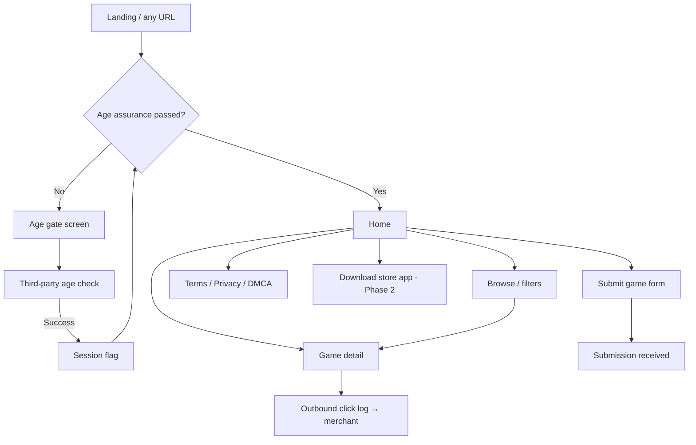

# UI layout and page structure

**Date:** 14 October 2026  
**Status:** wireframes for implementation. Visual language from `docs/design-and-mascot.md`. Hosting context in `docs/architecture.md` (DigitalOcean Phase 1).  
**Breakpoints:** mobile `<768px`, tablet `768–1023px`, desktop `≥1024px`. Max content width `1280px`.

---

## Global chrome (post age gate)

Every catalog page shares the same shell so the store reads as one product, not a blog with game links.

```text
┌──────────────────────────────────────────────────────────────────────────────┐
│  HEADER  (#14061C bg, 3px bottom border #C026D3 or #241033)                   │
│  [♥ Vesper bust]  WORDMARK ♥     New   Browse   Submit game   [♥] (later)    │
│                                                      [Search……………]  (Phase 1b)│
├──────────────────────────────────────────────────────────────────────────────┤
│  MAIN  (scroll)                                                               │
│  … page content …                                                             │
├──────────────────────────────────────────────────────────────────────────────┤
│  FOOTER  (#241033 surface)                                                    │
│  Terms · Privacy · Affiliate disclosure · DMCA · ©                           │
│  Optional: single adult ad slot (728×90 desktop / 320×50 mobile), labeled    │
└──────────────────────────────────────────────────────────────────────────────┘
```

| Zone | Behavior |
| --- | --- |
| Header | Sticky on desktop; collapses to hamburger + wordmark on mobile. Search hidden until search ships. |
| Heart control | Reserved for favorites (logged-in, later). Hover uses primary `#C026D3`. |
| Footer | Legal links always visible; affiliate disclosure page linked from any paid outbound row. |

**Pre-gate:** no header catalog links, no game thumbnails, no footer ad slot. Only age assurance + legal minimum.

**Age gate is not a “page” in the nav.** Players never pick “Age gate” from a menu. Routing sends first-time (or expired) sessions to `/enter` (or a full-screen overlay), the vendor runs, then the app drops them on **Home**. Design previews may simulate that flow with a **dev-only** “Simulate first visit” toggle — not a tab beside Browse.

**PG preview mode (public demos):** wireframes, screenshots, and staging builds shown on open networks use neutral placeholder art, generic game titles, and copy like “Mature games catalog (18+)” — no explicit thumbnails or lewd sample text. Production after verification uses real listing art behind the gate.

---

## Storefront polish (catalog, not image board)

The catalog should feel like a **specialist game store** (Nutaku-shaped: curated rails, hero, chips) — not a flat grid of same-size boxes (Reddit / booru / basic image board).

| Image-board pattern (avoid) | Storefront pattern (target) |
| --- | --- |
| Uniform grid of bordered rectangles | **Mixed layout:** hero banner + horizontal **rails** with varied card widths |
| Every tile equal weight | **One featured tile** large; rail cards ~180–220px wide with peek |
| Metadata as plain text under box | **Art-first cards:** rounded cover, **gradient scrim** on art, title + platform **on or under** art |
| Filters as a bare sidebar | **Chip row** under hero (Platform, New, Browser…) + sort on the right |
| Hard outline on every cell | **Soft elevation:** `box-shadow` + optional **1px** inner highlight; reserve **thick** borders for CTAs and header rule |
| Static page | **Horizontal scroll** sections with snap; subtle hover scale on cards |

**Home structure (Nutaku-like)**

```text
┌──────────────────────────────────────────────────────────────────────────────┐
│  HEADER  logo · pill nav · search · [♥ Wallet 1,240] · Sign in · Submit (dev)   │
│          Wallet = Phase 3 live-ops; v1 shows disabled/tooltip or hides until   │
│          accounts ship. Sign in = email magic link for favorites (Phase 1b).   │
├──────────────────────────────────────────────────────────────────────────────┤
│  HERO CAROUSEL  (1–3 slides, 21:9 crop, gradient overlay, single CTA pill)      │
├──────────────────────────────────────────────────────────────────────────────┤
│  CHIP ROW   [ All ] [ New ] [ Windows ] [ Browser ] [ Android ]  → scroll      │
├──────────────────────────────────────────────────────────────────────────────┤
│  Section: Top grossing                   [ See all ]   ← rank #1–#10 on art    │
│  ◀  ┌─①───┐ ┌─②───┐ ┌─③───┐ ┌─④───┐ ┌─⑤───┐  ▶   badge: gold/silver/bronze │
│     │     │ │     │ │     │ │     │ │     │       for #1–#3 optional        │
├──────────────────────────────────────────────────────────────────────────────┤
│  Section: Popular now                    (clicks / editorial; may overlap)      │
├──────────────────────────────────────────────────────────────────────────────┤
│  Section: New releases                   (second rail, same card component)    │
├──────────────────────────────────────────────────────────────────────────────┤
│  FOOTER                                                                         │
└──────────────────────────────────────────────────────────────────────────────┘
```

**Card component:** `rounded-2xl`, overflow hidden, art aspect **3:4** or **16:9** per section, bottom gradient `transparent → #14061C`, sponsored **pill** on art (top-left). Favorite heart top-right. **Rank badge** (top-left or overlapping art corner): `#1`–`#10` on **Top grossing** rail — bold tabular nums, `#FF4D8D` fill for top 3. Data source: `listing.chart_rank` / `chart_bucket` (`docs/data-and-ingest.md`). No separate “title bar” box unless typographic fallback cover.

**Header — wallet and sign-in (Nutaku-shaped, PG demo):**

| Control | Phase | Behavior |
| --- | --- | --- |
| **Wallet** | 3 | Balance + add funds; hidden or “Coming soon” in link-catalog phase |
| **Sign in** | 1b | Opens auth modal; favorites and email prefs when account exists |
| **Submit** | 1 | Developer listing form (always visible post-gate) |

Demo wireframes show wallet as a **pill** (`♥ 1,240` mock balance) and **Sign in** as outline button — clearly labeled mock in PG previews.

**Browse** keeps chips + sort at top; results use the **same card** in a responsive grid (2 col mobile, 4–5 desktop) — still not a bare image board because cards share the store chrome and section context.

**Detail:** wide hero art band (blurred edges optional), info panel as **surface card with thin border**, one primary gradient CTA — not a forum post layout.

Vesper appears in **hero corner**, age overlay, and empty states — not on every thumbnail.

---

## Screen map



---

## 1. Age gate (first visit)

No sexual content, no catalog previews. Vesper in **storefront** outfit frames the vendor flow.

### Desktop

```text
┌────────────────────────────────────────────────────────────────────────────┐
│                         full viewport #14061C                               │
│                                                                             │
│     floating geometric hearts (soft #F9A8D4, accent #FF4D8D)                │
│                                                                             │
│              ┌─────────────────────┐    ┌──────────────────────────────┐   │
│              │                     │    │  Adults only                 │   │
│              │   Vesper full-body  │    │  This catalog lists 18+ games.│   │
│              │   (storefront)      │    │                              │   │
│              │                     │    │  ┌──────────────────────────┐ │   │
│              │                     │    │  │ Age vendor widget /     │ │   │
│              │                     │    │  │ redirect (primary CTA)   │ │   │
│              └─────────────────────┘    │  └──────────────────────────┘ │   │
│                                         │  Wordmark ♥ (small)           │   │
│                                         │  Terms · Privacy (text links) │   │
│                                         └──────────────────────────────┘   │
│                                                                             │
└────────────────────────────────────────────────────────────────────────────┘
```

### Mobile

Stack: wordmark → card (copy + vendor CTA) → smaller Vesper below or as card header crop. Hearts reduced to avoid clutter.

**Do not** use a lone “I am 18” checkbox as the only control (`docs/gaps.md`).

---

## 2. Home

Purpose: **curated storefront** — hero, chips, two or more scroll rails (Popular, New, Sponsored). PG demos use abstract gradient covers only.

### Desktop

See **Storefront polish** diagram above. Copy example (PG): “Discover mature games for PC, browser, and Android.”

### Mobile

- Hero → single full-bleed slide with swipe dots.
- Chips → horizontal scroll.
- Rails → one row visible, snap scroll; card width ~42% viewport.

**Game card anatomy (store tile, not forum thumbnail)**

```text
┌─────────────────────┐
│ ♥              [Ad] │  ← optional badges on art
│                     │
│   ART + gradient    │  ← 3:4; typographic or licensed
│   scrim at bottom   │
│                     │
│  Title on scrim     │
│  Win · Browser      │
└─────────────────────┘
   soft shadow, rounded-2xl — no heavy box border
```

---

## 3. Browse

Filters in a left rail (desktop) or top sheet (mobile).

### Desktop

```text
┌──────────────────────────────────────────────────────────────────────────────┐
│ HEADER                                                                        │
├───────────────┬──────────────────────────────────────────────────────────────┤
│ FILTERS       │  RESULTS  (sort: New · Updated)                              │
│ surface card  │  ┌──────┐ ┌──────┐ ┌──────┐ ┌──────┐                          │
│               │  │      │ │      │ │      │ │      │                          │
│ Platform      │  └──────┘ └──────┘ └──────┘ └──────┘                          │
│ □ Windows     │  … paginated …                                                │
│ □ Android     │                                                               │
│ □ Browser     │                                                               │
│               │                                                               │
│ v1 tags       │                                                               │
│ (minimal)     │                                                               │
│               │                                                               │
│ [Clear]       │                                                               │
└───────────────┴──────────────────────────────────────────────────────────────┘
```

Sexual-content facets expand after tag vocabulary exists (`docs/gaps.md`). v1 ships platform + sort only.

---

## 4. Game detail

Primary job: one obvious **Get game** outbound action and honest affiliate disclosure.

### Desktop

```text
┌──────────────────────────────────────────────────────────────────────────────┐
│ HEADER                                                                        │
├──────────────────────────────────────────────────────────────────────────────┤
│  ┌────────────────────────────┐  ┌─────────────────────────────────────────┐ │
│  │                            │  │  GAME TITLE (heavy geometric sans)       │ │
│  │   Key art / typographic    │  │  Platforms: Windows, Browser             │ │
│  │   large surface card       │  │  Updated: … · Source: Steam / itch / …   │ │
│  │                            │  │                                          │ │
│  └────────────────────────────┘  │  ┌─────────────────────────────────────┐ │ │
│                                  │  │  ♥  Get game  (primary #C026D3)    │ │ │
│                                  │  └─────────────────────────────────────┘ │ │
│                                  │  Affiliate: “We may earn from this link” │ │
│                                  │  Secondary: Official site (if different)│ │
│                                  └─────────────────────────────────────────┘ │
├──────────────────────────────────────────────────────────────────────────────┤
│  About this listing  (short, our copy only — no scraped store description)   │
├──────────────────────────────────────────────────────────────────────────────┤
│  FOOTER                                                                       │
└──────────────────────────────────────────────────────────────────────────────┘
```

Phase 2 adds a second button **Download from store** (hosted build) below outbound, only when licensed.

### Mobile

Art full width → title → full-width primary CTA → disclosure → about.

---

## 5. Submit game (developer)

Single column form, max width `640px`, centered.

Fields: official URL, contact email, platforms (checkboxes), optional message.  
Submit → thank-you state with queue expectation (review, not instant publish).

Vesper: none required; optional small bust in empty sidebar on desktop only.

---

## 6. Legal pages

Simple prose layout: title, last updated, body in muted readable width (`max-w-prose`). Same header/footer as catalog.

---

## 7. Download store app (Phase 2)

Dedicated route linked from header when APK exists.

```text
┌──────────────────────────────────────────────────────────────────────────────┐
│  [Vesper bust] + WORDMARK side by side                                        │
│  “Install the store app (Android)”                                            │
│  Steps: 1 Allow unknown sources  2 Download APK  3 Open installer           │
│  [Download APK]  primary button                                               │
│  SHA-256 fingerprint shown for trust                                          │
│  QR code for mobile-on-desktop                                                │
└──────────────────────────────────────────────────────────────────────────────┘
```

Launcher icon: Vesper bust only (storefront outfit).

---

## 8. Android app shell (Phase 2 preview)

Same palette and card anatomy as web. Bottom nav for thumb reach.

```text
┌─────────────────────────┐
│ App bar: ♥ Store        │
├─────────────────────────┤
│                         │
│   (same card grid as    │
│    mobile web home)     │
│                         │
├─────────────────────────┤
│ Home · Browse · Library · Settings │
└─────────────────────────┘
```

**Library** = installed games from store-hosted builds only. Phase 1 app is optional; web is enough for links.

---

## Component inventory (build order)

| Component | Used on |
| --- | --- |
| `AgeGateOverlay` | Route guard / first visit only — **not** in site nav |
| `SiteHeader` / `SiteFooter` | All post-gate |
| `HeroCarousel` | Home |
| `FilterChips` | Home, browse |
| `GameCard` | Home rails, browse grid |
| `ScrollRail` | Home sections |
| `TopGrossingRail` | Home — ranked cards `#1`–`#10` |
| `RankBadge` | Top grossing cards |
| `WalletPill` / `SignInButton` | Header (wallet gated by phase) |
| `FilterPanel` | Browse |
| `OutboundCTA` | Detail |
| `SponsoredBadge` | Featured cards |
| `TypographicCover` | Default art |
| `LegalPageLayout` | Terms, privacy, DMCA |
| `AdSlot` | Home footer band (optional) |

---

## Spacing, borders, and type (implementation tokens)

| Token | Value |
| --- | --- |
| Page padding | `16px` mobile, `24px` tablet, `32px` desktop |
| Card radius | **`16px` (`rounded-2xl`)** on catalog tiles; `12px` on forms |
| Card gap | Rail: `12px`; grid: `16–20px` |
| **Catalog tile border** | Prefer **none** + shadow `0 8px 24px #00000055`; optional `1px` `#ffffff14` inner edge |
| **Border — panel / CTA** | `2–3px solid` `--primary` on info panels and primary buttons only |
| **Border — header / footer rule** | `3px solid` `--primary` |
| **Border — featured / sponsored tile** | `3px solid` `--accent-hot` |
| **Border — primary button** | `3px solid` `#FF4D8D` (optional outer ring) or same as fill with `3px` bottom shadow edge |
| **Border — viewport / modal** | `4px solid` `--primary` |
| Display / page title | Geometric sans, **`800–900`**, tight tracking |
| Nav links, section heads | **`700–800`**, `#FFF1F7` or `#FF4D8D` for section labels |
| Card title | **`700`**, `#FFF1F7` |
| Body / metadata | `14–16px`, **`600`**, `#E9D5FF` (muted but bold) |
| Legal prose | **`500–600`** max — only place slightly lighter weight is allowed |

Map colors to CSS variables: `--bg`, `--surface`, `--primary`, `--accent-hot`, `--text`, `--text-muted`, `--border`, `--border-strong` per `docs/design-and-mascot.md`.

---

## Related

- Brand and mascot: `docs/design-and-mascot.md`
- Infrastructure: `docs/hosting.md`, `docs/architecture.md` → **Initial hosting on DigitalOcean**
- Interactive wireframes (brand colors, mobile toggle): [NSFW-Droid UI layout wireframes](https://cursor.com/canvas/store-becc70ce-ef76-4c20-8155-94b79e3477ff/c5ce481c-cc7c-4b10-a1c4-ca8b17e49f28)
