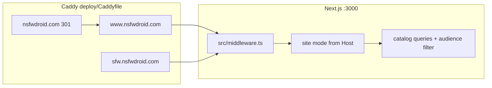
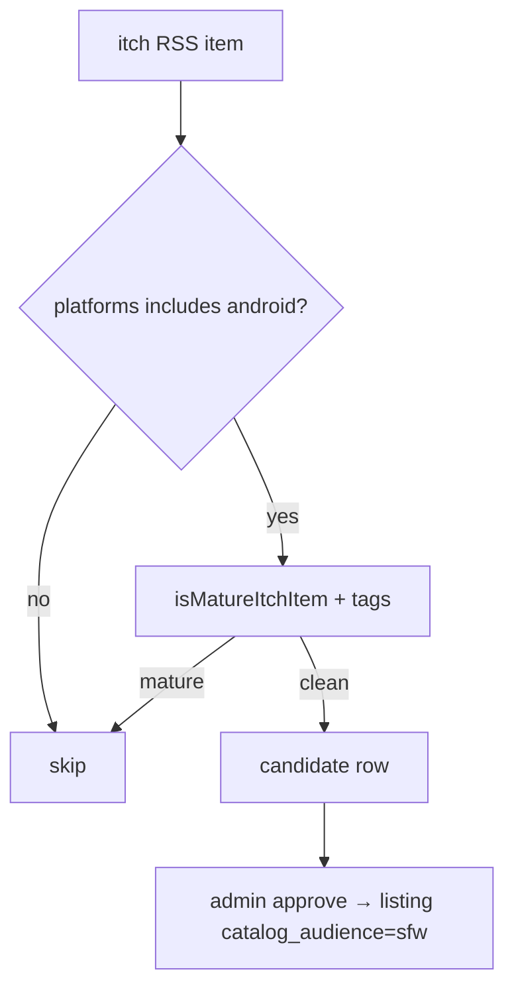

# SFW Android catalog — subdomain concept

**Date:** 30 October 2026  
**Status:** owner-facing research / design only — no routes or ingest changes yet.  
**Related:** [architecture.md](architecture.md), [data-and-ingest.md](data-and-ingest.md), [design-and-mascot.md](design-and-mascot.md), [shop-design-concepts.md](shop-design-concepts.md).

---

## What we are proposing

A **separate hostname** under `nsfwdroid.com` that lists **safe-for-work Android game titles** (itch / Play-style outbound links only — same Phase 1 model as the main catalog). It reuses the storefront UX (hero, rails, platform chips) but drops or softens the 18+ gate and NSFW ingest filters.

**Honest brand tension:** the registrable apex still says **NSFW**. A subdomain cannot fully erase that for app-store reviewers, school filters, or parents — but **`sfw.`** makes intent explicit for SEO, Search Console, and PG ad networks. Benefits of one droplet + one Next.js deploy: shared admin, ingest jobs, and ops playbooks.

---

## Subdomain name options

| Host | Pros | Cons |
| --- | --- | --- |
| **`sfw.nsfwdroid.com`** | Says exactly what it is; easy GSC property; pairs with future `www` cross-links | Still under an adult-branded registrable domain |
| **`android.nsfwdroid.com`** | Strong “Android games” SEO | Does **not** imply SFW; sounds like an APK store (Phase 2) |
| **`play.nsfwdroid.com`** | Short, action-oriented | Collides with Google Play mental model; ambiguous maturity |

**Recommendation:** **`sfw.nsfwdroid.com`** — maturity signal matters more than platform keyword in the hostname; Android scope is handled in UI (default platform chip, ingest feeds, copy).

---

## Current stack (what exists today)

| Area | Today |
| --- | --- |
| **Caddy** (`deploy/Caddyfile`) | Apex → `www`; only `www.nsfwdroid.com` and IP vhost proxy `:3000` |
| **Middleware** (`src/middleware.ts`) | 301 apex → `www`; security headers; `noindex` on admin/go/ads — **no host-based catalog modes** |
| **Canonical** (`src/lib/canonical-host.ts`, `layout.tsx` `metadataBase`) | Single origin from `NEXT_PUBLIC_SITE_URL` (`www`) |
| **Age gate** (`AgeGate`, `/api/age-gate`, `age_verified` cookie) | Full-screen 18+ on home, browse, game detail, videos |
| **Catalog data** | PGlite/Postgres `listing` rows — **no `content_rating` column** |
| **NSFW enforcement** | Default `CATALOG_NSFW_ONLY=1`, `ITCH_NSFW_ONLY=1`; `isMatureCatalogCandidate()` in `src/lib/catalog-maturity.ts`; non-mature rows rejected or cleaned by `scripts/unpublish-non-nsfw-listings.ts` |
| **Browse “vanilla”** | **Not SFW** — hides *niche* NSFW tags on `/browse?vanilla=1`, still adult catalog |
| **Android on home** | Client-side chip filter in `ChipRow` / `Storefront` (`platforms` array includes `android`) |
| **Ads** | ExoClick footer + popunder; gated on `age_verified` (`src/lib/ads-config.ts`) |

---

## Technical shapes (compare)

### A — Same Next.js app, host-based “site mode” (recommended if built)

- **Caddy:** add `sfw.nsfwdroid.com { reverse_proxy 127.0.0.1:3000 }` (same process as `www`).
- **App:** resolve mode from `Host` (middleware or server layout): `sfw` vs `main`.
- **Catalog queries:** filter `platforms @> '{android}'` **and** SFW eligibility (new field or tag — see [Data](#data-sfw-eligibility)).
- **Theme:** alternate CSS tokens (cooler teal/cyan palette — shop doc already uses `#22FF88` greens as a PG-ish direction).
- **Age gate:** skip or replace with lightweight “13+ / general audience” copy + cookie (no blur on covers for SFW mode).
- **SEO:** `metadataBase` / canonical URLs must be **host-aware** (`https://sfw.nsfwdroid.com/game/...`) — today `NEXT_PUBLIC_SITE_URL` is build-time single-origin; host detection in server components fixes this without a second build.

**Pros:** one deploy, one admin queue (with labels), shared link checker.  
**Cons:** must audit every route (creators hubs, videos, newsletter) for **hide or noindex** on SFW host; risk of leaking NSFW rows if filter is wrong.

### B — Path prefix only (`www.nsfwdroid.com/sfw/...`)

- **Pros:** no DNS; reuse single canonical site URL.
- **Cons:** “NSFW Droid” wordmark and `/sfw` under adult site hurts positioning; age gate and ExoClick context remain on same property; worse for PG ads and school filters; GSC still one mixed-intent property.

**Use when:** prototyping only — not a long-term product surface.

### C — Separate lightweight deploy on subdomain

- Second systemd unit or container, env `CATALOG_MODE=sfw`, optional **separate PGlite directory** or DB schema slice.
- **Pros:** blast-radius isolation; SFW build can omit popunder scripts entirely.
- **Cons:** two releases, two health checks, 512MB droplet pressure; shared DB without strict row-level labels is dangerous.

**Use when:** compliance or ad network requires hard separation — otherwise prefer **A** with strong row labels and tests.

---

## Product UX

| Element | Main site (`www`) | SFW subdomain |
| --- | --- | --- |
| **Wordmark** | NSFW**Droid** (magenta accent) | **SFW** Droid or “SFW Droid” with **Andri** mark — avoid “NSFW” in header |
| **Mascot** | Vesper ecchi host + Andri icon | **Andri-first** (PG bust already in header); Vesper only in **storefront-outfit** poses if any |
| **Palette** | Violet `#14061C`, magenta `#C026D3` | Cooler: deep blue-violet bg, teal/cyan primary (align with shop token experiment) |
| **Age** | Hard 18+ gate + cover blur pre-gate | Optional minimal age (13+) or none — **legal review** before dropping gate entirely |
| **Nav** | Full: New, Browse, Creators, Videos, … | Slim: Home, Browse, Submit; hide adult hubs / creator NSFW sections |
| **Footer** | Standard legal + affiliate | Same legal entity; **cross-link:** “18+ catalog → www.nsfwdroid.com” / “Family-friendly Android → sfw.nsfwdroid.com” |
| **SEO canonical** | Per-host canonical URLs; **no** cross-canonical between hosts; sitemap per property |

---

## Data — SFW eligibility

Today’s pipeline **only admits mature titles** (`catalog-maturity.ts`, itch NSFW browse feeds in `scripts/lib/itch-feeds.ts`). There is **no** inverse “SFW flag” on `listing`.

**Likely implementation path:**

1. **Schema:** `listing.catalog_audience` enum (`nsfw` | `sfw`) or boolean `sfw_ok` set at approve time.
2. **Ingest:** additional feeds, e.g. `https://itch.io/games/platform-android.xml` (non-NSFW browse), genre feeds without adult tags; **per-item** reject if mature keywords/tags match existing regexes.
3. **Steam:** filter **out** adult descriptors (inverse of `isMatureSteamPayload`); expect **few** Android-native Steam rows.
4. **Manual:** admin approvals for Play Store pages (no automated Play ingest in v1).
5. **Do not** reuse browse `?vanilla=1` — that only deprioritizes niche **adult** tags (`listings-ranking.ts`).

**Launch content:** expect **manual curation + itch SFW Android feeds** until volume justifies automation; main catalog rows are overwhelmingly NSFW-tagged and unsuitable to “filter invert.”

**Schema today (`src/db/schema.ts`):** the `listing` table has `platforms`, `source`, tags via `listing_tag`, and `storeDescription` — **no** audience or maturity column. Any SFW slice needs a migration plus query-layer guards so a single missed `WHERE` cannot expose adult rows on `sfw.`.

---

## Evidence from the current codebase

This section ties the concept to **files that already exist** — not hypothetical greenfield work.

| Claim | Where it lives | Implication for SFW |
| --- | --- | --- |
| Only `www` (+ apex redirect) terminates TLS to Next | `deploy/Caddyfile` — blocks for `nsfwdroid.com` (301) and `www.nsfwdroid.com` (reverse_proxy) | Adding `sfw.nsfwdroid.com` is a **new Caddy site block**, same upstream port |
| Apex → www canonicalization | `src/lib/canonical-host.ts` — `redirectHostForCanonicalOrigin()` only maps bare apex to `primarySiteHost()` | **`sfw.` is not redirected today**; must stay that way (do not fold SFW into www redirect) |
| Middleware has no site mode | `src/middleware.ts` — security headers + selective `X-Robots-Tag` on admin/go/ads | Host-based routing belongs here or in a small `src/lib/site-mode.ts` helper used by layouts |
| Single build-time origin | `src/app/layout.tsx` `metadataBase: new URL(siteUrl)`; `src/lib/site.ts` / `NEXT_PUBLIC_SITE_URL` | Game URLs in OG tags and JSON-LD must become **request-host-aware** on SFW |
| Sitemap is www-scoped | `src/app/sitemap.ts` — all URLs prefixed with `siteUrl`; includes `/videos`, `/creators/*` | SFW needs **filtered sitemap** (Android + `catalog_audience=sfw` only) or separate route `sitemap.xml` by Host |
| NSFW-only ingest default | `src/lib/catalog-maturity.ts` — `isCatalogNsfwEnforcementEnabled()` / `isItchNsfwOnlyMode()` default **true** | SFW ingest is a **second pipeline** with inverted reject rules, not toggling `CATALOG_NSFW_ONLY=0` on main cron |
| itch feeds are adult browse | `scripts/lib/itch-feeds.ts` — `ITCH_NSFW_BROWSE_FEEDS` (incl. `platform-android/tag-nsfw.xml`) | SFW uses **different feed list** (e.g. `platform-android.xml` without `/tag-nsfw`) + `isMatureItchItem()` **reject** |
| Browse “vanilla” ≠ family-safe | `src/lib/browse-listings.ts` — `vanillaOnly` filters niche tags via `FEATURED_RAIL_NICHE_TAG_SLUGS`, not maturity | Document prominently so PM/engineering do not ship “vanilla mode” as SFW |
| Age gate is global on storefront | `src/components/Storefront.tsx`, `BrowseCatalog.tsx`, `GameDetailPage.tsx` — `<AgeGate open={!ageVerified} />` | SFW layout branch skips or replaces gate; cookie name can stay `age_verified` with different copy or use host-scoped cookie |
| Ads gated on age cookie | `src/components/AdSlot.tsx` — ads after `age_verified` | SFW should omit ExoClick entirely until PG network; see `src/lib/ads-config.ts` |
| Stale NSFW cleanup exists | `scripts/unpublish-non-nsfw-listings.ts` (main catalog hygiene) | Mirror with **`unpublish-sfw-ineligible`** or shared maturity helper tests |



---

## SEO and Search Console rationale

**Why a subdomain beats `/sfw` on www for this product:**

| Factor | `www.nsfwdroid.com/sfw/...` | `sfw.nsfwdroid.com` |
| --- | --- | --- |
| GSC property intent | Mixed adult + family URLs under one URL prefix | **Dedicated URL-prefix property** or hostname group with clear audience |
| SERP snippet context | Title still “NSFW Droid” in most templates | Header/wordmark can say **SFW Droid** without rewriting apex brand |
| `robots.txt` / sitemap | One sitemap lists `/videos`, creator hubs, adult games | SFW sitemap lists **only** eligible Android game detail + browse |
| Canonical policy | Risk of accidental `rel=canonical` to www game URL | Per-host canonical: `https://sfw.nsfwdroid.com/game/{slug}` |
| Link equity | Internal links from adult rails | Footer **cross-links** only; no `canonical` cross-host (Google treats as separate sites) |

**Alignment with existing SEO fixes:** apex → www 301 in Caddy matches `redirectHostForCanonicalOrigin()` — the same pattern should **not** force `sfw` → `www`. Register `sfw.nsfwdroid.com` in GSC after DNS; submit sitemap after launch content exists (empty sitemap is worse than delayed submit).

**Structured data:** reuse game detail templates but ensure `metadataBase` and `@id` URLs use the SFW host when `siteMode === 'sfw'` so rich results do not point at www.

---

## Security and filter failure modes

| Failure | How it could happen | Impact | Mitigation |
| --- | --- | --- | --- |
| **NSFW row on SFW home** | Query missing `catalog_audience = 'sfw'` | Reputation, school filter block, ad network ban | DB column + **default deny** in shared `publicCatalogWhere()`; integration test: no listing without `sfw` on SFW host |
| **Shared slug, wrong host** | Same slug published on both audiences | User shares www link from SFW context | Optional **slug namespace** (`pg-pixel-quest` vs `pixel-quest`) or 404 on wrong host |
| **Creator / video routes on SFW** | Next file-based routes still reachable | Adult hub indexed on SFW property | Middleware **404 or 301 to /** for `/videos`, `/creators/*` on SFW host; `X-Robots-Tag: noindex` belt-and-suspenders |
| **Admin on SFW host** | `/admin` works on any Host | Odd cookie scope | Keep admin on www only — redirect SFW `/admin` → www |
| **Open redirect via `/api/go`** | Outbound still works | Less critical but mixes tracking | Allow go URLs on SFW for **sfw listings only** (validate listing audience server-side) |
| **Ingest misconfiguration** | `CATALOG_NSFW_ONLY=0` on main cron | Non-mature rows enter **main** catalog | Never disable NSFW enforcement globally; separate `INGEST_PROFILE=sfw` script |
| **Cover art** | itch RSS image is suggestive though tags pass | Visual NSFW leak | Manual approve queue for SFW until image classifier or stricter itch filters |
| **Vanilla browse confusion** | Marketing says “vanilla = safe” | Users see adult titles | Docs + UI: vanilla = **niche tag hide**, not PG |

---

## Failure modes and guardrails (engineering)

1. **Single helper for “public catalog SQL”** — today `publicCatalogLinkStatus()` and friends in listing queries; extend with `forSiteMode(mode)` so every browse/home/sitemap path cannot forget the audience predicate.
2. **Automated tests** — fixture listings: `{ audience: nsfw }` must never appear in SFW query snapshots; copy patterns from existing catalog tests under `src/lib/`.
3. **Cron isolation** — SFW ingest via `catalog-ingest-cron.sh` wrapper with `CATALOG_AUDIENCE=sfw` env, separate log file under `/var/log/nsfwdroid/` (same as main ingest in [autonomous-ops.md](autonomous-ops.md)).
4. **Feature flag** — `SFW_HOST_ENABLED=0` until row count &gt; N; Caddy can serve maintenance page on `sfw.` until flag on (optional).
5. **Watchdog** — `ensure-nsfwdroid.sh` already hits `/api/health`; optional second check `Host: sfw.nsfwdroid.com` after launch.
6. **Rollback** — remove Caddy block + DNS; no need to redeploy if feature-flagged off in app.

---

## Host-mode implementation sketch (no full code)

**Resolve mode early:**

```text
Host header → normalize → siteMode: 'main' | 'sfw'
  sfw.nsfwdroid.com     → sfw
  www.nsfwdroid.com     → main
  nsfwdroid.com         → (middleware already 301 to www)
```

**Suggested touch points (order of work):**

| Step | File(s) | Change |
| --- | --- | --- |
| 1 | `src/lib/site-mode.ts` (new) | `getSiteMode(request)`, `siteUrlForMode(mode)` |
| 2 | `src/middleware.ts` | Block or redirect disallowed paths on SFW; optional `Vary: Host` on cache-sensitive routes |
| 3 | `src/app/layout.tsx` | Branch metadata / theme class on mode |
| 4 | `src/lib/browse-listings.ts`, home data loaders | Add audience + default `platforms` contains `android` on SFW |
| 5 | `src/app/sitemap.ts`, `src/app/robots.ts` | Host-aware or split sitemap generation |
| 6 | `src/components/Storefront.tsx` | SFW wordmark, no AgeGate blur, cross-link banner |
| 7 | Admin approve UI | Set `catalog_audience` when publishing |

**Caching note:** ISR revalidation in `src/lib/catalog-revalidate.ts` applies to both hosts if shared; tag invalidation must refresh **both** sitemaps if ever dual-hosted on same build.

---

## Ingest strategy — SFW itch feeds

**Do not** point main `ingest-all.ts` at non-NSFW global feeds while `isCatalogNsfwEnforcementEnabled()` is on — candidates from `https://itch.io/feed/new.xml` would still be **rejected** unless mature, wasting cron time.

**Proposed SFW feed set (starting point — validate in staging):**

| Feed URL | Role |
| --- | --- |
| `https://itch.io/games/platform-android.xml` | Broad Android browse (non–tag-nsfw) |
| `https://itch.io/games/platform-android/price-free.xml` | Free Android |
| `https://itch.io/games/genre-action/platform-android.xml` | Genre slices without adult tags |
| Manual / admin | Play Store outbound links (no Play API in v1) |

**Per-item pipeline (mirror main ingest):**



**Reuse:** `textHasMatureKeyword`, `MATURE_TAG_SLUGS`, and Steam `isMatureSteamPayload()` for **reject** on SFW ingest; Steam Android-native volume is low but descriptors must still be checked.

**Env sketch:**

```bash
# /etc/nsfwdroid.env — illustrative second cron entry, not production today
CATALOG_AUDIENCE=sfw
ITCH_NSFW_ONLY=0
CATALOG_NSFW_ONLY=0          # inverted logic: REJECT mature, accept clean
ITCH_SFW_FEED_URLS=https://itch.io/games/platform-android.xml,...
```

Implement `ITCH_SFW_FEED_URLS` in `scripts/lib/itch-feeds.ts` as a sibling to `ITCH_NSFW_BROWSE_FEEDS` when coding — doc only names the intent.

---

## Legal, ads, and monetization

| Topic | Main site today | SFW subdomain guidance |
| --- | --- | --- |
| **Age gate** | 18+ `AgeGate` + blur (`src/components/AgeGate.tsx`) | Lightweight 13+ or informational only — **owner legal review** before dropping gate |
| **Terms / privacy** | `/terms`, `/privacy` on www | Same legal entity; link from SFW footer; mention dual catalogs |
| **ExoClick** | Footer + popunder when ads enabled | **Off** on SFW until PG-approved network; never load popunder script on SFW layout |
| **Affiliate** | itch / Steam outbound | Same disclosure pages; only SFW-eligible titles |
| **DMCA / reports** | `listing_report` flow | Same admin queue; filter column by audience |

School and corporate filters look at **domain reputation** (`nsfwdroid.com` substring) — SFW subdomain improves **human and reviewer signaling**, not guaranteed filter allowlisting.

---

## Metrics and success criteria

**Launch (first 30 days after go-live):**

| Metric | Target (example) | Source |
| --- | --- | --- |
| SFW indexed URLs (GSC) | &gt; 50 game detail pages | GSC coverage report |
| Crawl errors on `sfw.` | 0 “Soft 404” from empty catalog | GSC |
| NSFW leakage incidents | **0** confirmed | Manual QA + user reports |
| Ingest adds per run | &gt; 0 new SFW candidates (median) | Ingest logs / optional `INGEST_ALERT` variant |
| Health | `GET https://sfw.nsfwdroid.com/api/health` 200 | Watchdog / uptime |

**Product:** Android chip selected by default; bounce rate not primary — focus on **outbound click-through** to itch/Play from SFW rails.

---

## Phased rollout checklist

| Phase | Owner | Tasks |
| --- | --- | --- |
| **0 — Doc / design** | Done | This doc + [shop-design-concepts.md](shop-design-concepts.md) visuals |
| **1 — Schema** | Dev | Migration `catalog_audience`; backfill none (empty SFW) |
| **2 — App mode** | Dev | `site-mode`, query guards, SFW layout, route blocks |
| **3 — Ingest** | Dev | SFW cron + feed list; admin approve UX |
| **4 — Staging** | Dev | Host header tests; leak test suite |
| **5 — DNS** | Owner | `A`/`AAAA` for `sfw` → droplet (see [cloudflare.md](cloudflare.md)) |
| **6 — Caddy** | Owner/agent | Add block below; `caddy reload` in **maintenance window** ([autonomous-ops.md](autonomous-ops.md#human-scheduled-changes-dns-deploy-maintenance)) |
| **7 — Content** | Owner | Approve seed list (~30–50 titles) |
| **8 — GSC** | Owner | Property + sitemap submit |
| **9 — Ads** | Owner | Keep ads off until PG partner |

---

## Ops

**DNS:** `A`/`AAAA` for `sfw` → same droplet as `www`.

**Caddy — match existing `www` block pattern** (`deploy/Caddyfile` lines 18–27 today). Insert **after** the `www.nsfwdroid.com` block:

```caddy
# PG Android catalog — same Next process as www; Host header drives site mode in app.
sfw.nsfwdroid.com {
	encode gzip
	reverse_proxy 127.0.0.1:3000

	handle_errors 502 503 504 {
		root * /var/www/nsfwdroid/deploy
		rewrite * /maintenance.html
		file_server
	}
}
```

Do **not** add a redirect from `sfw` to `www` (unlike apex). TLS certificates: Caddy on-demand TLS or pre-provisioned cert for `sfw.nsfwdroid.com` once DNS resolves.

**Env (droplet `/etc/nsfwdroid.env` — illustrative):**

- Host mode can be runtime; optional `SFW_HOST=sfw.nsfwdroid.com` for sitemap/cookie domain scoping.
- Separate itch feed list env for SFW ingest job (or second cron calling ingest with `CATALOG_AUDIENCE=sfw`).
- **Ads:** disable ExoClick on SFW (`NEXT_PUBLIC_ADS_ENABLED=0`) until a PG network is approved; no popunder on family surface.
- **Analytics:** separate GA4 property or dimension `site_mode=sfw` if enabled.

**Search Console:** register **URL-prefix** or domain property including `sfw.nsfwdroid.com`; submit dedicated sitemap.

**Deploy:** same tarball flow as [deploy-droplet.md](deploy-droplet.md); Caddy reload after DNS cutover — prefer [autonomous-ops maintenance window](autonomous-ops.md#human-scheduled-changes-dns-deploy-maintenance).

---

## Wireframe — `sfw.nsfwdroid.com` home (PG storefront)

Mirror `Storefront.tsx` rails; default **Android** chip; no blur; Andri header.

```text
┌──────────────────────────────────────────────────────────────────────────────┐
│ HEADER  [Andri] SFW Droid     Home  Browse  Submit          [♥] Sign in      │
│         "128 Android games" badge (example)                                   │
├──────────────────────────────────────────────────────────────────────────────┤
│ HERO (single featured title — PG capsule art, no ecchi host)                  │
│  ┌──────────────────────────────┐  Featured: "Pixel Quest RPG"               │
│  │  cover 16:9                   │  Short store synopsis (2 lines max)       │
│  └──────────────────────────────┘  [ View game ]                              │
├──────────────────────────────────────────────────────────────────────────────┤
│ CHIPS  [ Android* ] [ All ] [ New ] [ Browser ] …   (*default active)       │
├──────────────────────────────────────────────────────────────────────────────┤
│ Rail: New on Android          horizontal GameCards, PG covers                 │
├──────────────────────────────────────────────────────────────────────────────┤
│ Rail: Free & notable          optional editorial picks                        │
├──────────────────────────────────────────────────────────────────────────────┤
│ BANNER  Looking for 18+ titles? → www.nsfwdroid.com (outbound, new tab)     │
├──────────────────────────────────────────────────────────────────────────────┤
│ FOOTER  Terms · Privacy · DMCA · Affiliate · © SFW Droid / NSFW Droid       │
└──────────────────────────────────────────────────────────────────────────────┘
```

---

## Decision summary

| Question | Guidance |
| --- | --- |
| Build now? | **No** — needs schema + ingest + host-aware SEO; doc-only planning is sufficient |
| Best hostname? | **`sfw.nsfwdroid.com`** |
| Best architecture? | **Same app, host-based mode (A)** unless an ad/compliance partner mandates split deploy |
| Biggest gap? | **Data** — current DB is NSFW-only; SFW is a new catalog slice, not a filter on existing rows |
