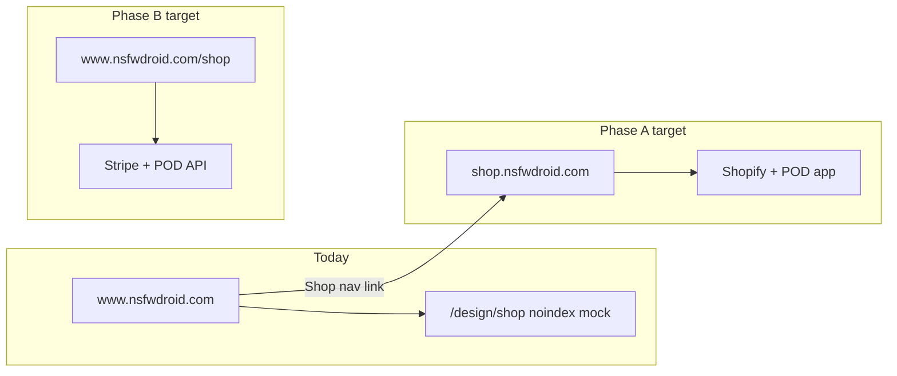

# NSFW Droid Shop — Storefront blueprint

**Audience:** Owner / product  
**Date:** 30 October 2026  
**Status:** Design mock only — no live checkout, cart API, inventory, or `shop.nsfwdroid.com` DNS in production yet.

> **Planning phase (Oct 2026):** Catalog storefront behavior — chibi badges, product taxonomy, rails, PDP variants, and JSON catalog shape — is specified in **[shop-catalog-planning.md](shop-catalog-planning.md)**. Implement that doc after owner sign-off; this blueprint remains the “what exists in repo / assets / gaps” index. **Chibi standees:** only on badge-tagged SKUs (not every card), **right-aligned** on the product image with **dynamic `-{N}%`** on the flag for percent-off sales — see catalog planning § Chibi badge system.

**Related docs:** [shop-catalog-planning.md](shop-catalog-planning.md) (catalog IA + badges + matrix), `docs/shop-design-concepts.md` (IA, SKUs, automated checkout target), `docs/shop-layout-mockups.md` (dev preview + canvas link).

---

## URL and hosting

| Item | Detail |
| --- | --- |
| **Production target** | `https://shop.nsfwdroid.com` — subdomain of `nsfwdroid.com` (no separate domain). |
| **Catalog stays** | Game listings remain on `https://www.nsfwdroid.com`. Shop is a sibling surface, not a replacement catalog. |
| **Phase A (launch fast)** | **Shopify** (or similar) on `shop.nsfwdroid.com` + Printful/Printify app. Shopify owns cart, tax, payment, webhooks to POD. Header **Shop** can link out until Phase B ships. |
| **Phase B (brand-locked)** | **Headless** shop routes in the Next.js app on the same origin as catalog: `/shop`, `/cart`, `/checkout`, Stripe Checkout + POD REST API from payment webhooks. |
| **Today in repo** | **`/shop`** (noindex preview, real approved JPGs) + **`/design/shop`** (noindex dev mock alias). No cart API, no Caddy vhost for `shop.` documented as live. |
| **SFW subdomain note** | `sfw.nsfwdroid.com` is a **separate** PG catalog concept (`docs/sfw-subdomain-catalog.md`) — not the merch shop host. |



---

## Page map

### Planned IA (from design concepts)

| Route | Purpose |
| --- | --- |
| `/shop` | Shop home — hero, collection chips, featured deal, product rails/grid |
| `/shop/collections/[slug]` | Merch · Digital · Bundles grid + sort |
| `/shop/products/[slug]` | PDP — gallery, variants, qty, add to cart |
| `/cart` | Slide-over drawer (desktop) + full cart page on mobile |
| `/checkout` | Contact → shipping (physical) → pay → confirm |
| `/order/[id]` | Receipt + support link |

**Nav (planned):** **Shop** between Browse and Submit (desktop pill); optional **New** badge at launch.

### What exists in the codebase today

| Route / artifact | Exists? | Notes |
| --- | --- | --- |
| `/design/shop` | **Yes** | `src/app/design/shop/page.tsx` → `ShopLayoutMockup.tsx`; `robots: noindex` — placeholder hero/grid regression |
| `/shop` | **Yes (preview)** | `src/app/shop/page.tsx` → shared `src/components/shop/*`; approved art in `public/shop/`; `robots: noindex` until owner enables |
| `/shop/collections`, `/shop/products`, cart | **No** | Not in this pass |
| Cart / checkout API | **No** | No webhooks, order DB, or shop env vars wired |
| Interactive tabbed mock | **Yes (canvas)** | Shop home, Collection, PDP, Cart drawer — see [Layout mockups canvas](https://cursor.com/canvas/store-71d7e49f-a003-4074-be74-ec6a867c57da/a2d41d50-20f5-429f-8f4c-6865e00a9827) |
| Branch `cursor/shop-layout-mockups-da0e` | **Yes** | Adds mock page, docs, component (merge to `main` enables owner/dev pixel-check) |

### What is **not built** (design doc only — summarize)

From `docs/shop-design-concepts.md` **Automated shop + checkout**:

- Payment capture (Stripe / Shopify Pay / adult processors — not chosen in code)
- POD order creation (Printful/Printify/Gelato API or Shopify app)
- Webhook handlers (`payment_intent.succeeded`, `package_shipped`, etc.)
- Digital delivery (signed URLs, `/api/shop/download?token=…`, Spaces objects)
- Production secrets (`STRIPE_*`, `PRINTFUL_*`, `SHOPIFY_*`, `SHOP_DOWNLOAD_SIGNING_SECRET` in `/etc/nsfwdroid.env`)
- Order persistence, email receipts, dispute workflow
- Launch SKU photography in `data/shop/mock/` (six hero products are **design targets** only)
- Spec components as production code: `ShopProductCard`, `ShopHero`, `ProductGallery`, `VariantPicker`, `CartDrawer`, `CheckoutSteps`, `ShopChipRow`

Checkout is drawn as a **shell** only in wireframes and canvas tabs — not implemented in the app.

---

## Wireframes (aligned with mockup component + canvas)

### Shop home

Static app mock (`ShopLayoutMockup`) implements **home slice only**. Full home + other views match the canvas tabs.

```text
┌──────────────────────────────────────────────────────────────────────────────┐
│ HEADER  [DroidMark] NSFWDroid    Browse   Shop(active)   Submit    Sign in   │
│         sticky · 3px primary border bottom · backdrop blur                    │
├──────────────────────────────────────────────────────────────────────────────┤
│ CALLOUT  "Design mockup — not wired to cart, checkout, or inventory."        │
├──────────────────────────────────────────────────────────────────────────────┤
│ HERO  aspect 16:9 · max-h 360px · surface card                               │
│  [dashed Vesper cutout]  Official NSFW Droid goods                           │
│                          Support the catalog — wear the droid.               │
│                          [Browse merch] [Digital packs]     tag: 16:9 banner │
├──────────────────────────────────────────────────────────────────────────────┤
│ CHIPS  (chip-scroll)  All | Merch | Digital | Bundles  — interactive in mock │
├──────────────────────────────────────────────────────────────────────────────┤
│ FEATURED DEAL  purple-bordered DEAL chibi placeholder + Supporter bundle $17   │
├──────────────────────────────────────────────────────────────────────────────┤
│ GRID PREVIEW  2×3 cards: sticker $12 · tee $28 · wallpaper $8 (STK/TEE/ZIP)  │
├──────────────────────────────────────────────────────────────────────────────┤
│ FOOTER NOTE  → collection, PDP, cart, checkout in canvas + docs              │
└──────────────────────────────────────────────────────────────────────────────┘
```

Canvas home tab adds: **Featured drop** card copy, **product grid** (4 SKUs including bundle), **callout strip** (“Ships from US · 18+ brand · Digital sales final”).

### Collection

```text
┌──────────────────────────────────────────────────────────────────────────────┐
│ HEADER (same chrome)                                                          │
├──────────────────────────────────────────────────────────────────────────────┤
│ Merch collection                          Sort: [ Featured ▼ ]               │
│ ┌────┐ ┌────┐ ┌────┐ ┌────┐                                                  │
│ │STK │ │TEE │ │ZIP │ │BND │  … responsive 4-col grid (canvas)               │
│ └────┘ └────┘ └────┘ └────┘                                                  │
└──────────────────────────────────────────────────────────────────────────────┘
```

### Product detail (PDP)

```text
┌──────────────────────────────────────────────────────────────────────────────┐
│ ← Back to Shop                                                                │
├──────────────────────────────┬───────────────────────────────────────────────┤
│ [ Main 1:1 image ]           │ Vesper sticker pack — Vol. 1                  │
│ [ thumb ][ thumb ][ thumb ]  │ $12.00 USD                                    │
│                               │ Variant: [ Sheet A ] [ Sheet B ]              │
│                               │ Qty  [ − ] 1 [ + ]                            │
│                               │ [ Add to cart ]                               │
│                               │ Secure checkout · Terms · Privacy             │
└──────────────────────────────┴───────────────────────────────────────────────┘
```

### Cart drawer

```text
┌───────────────────────────────┬────────────────────────── 280–400px ────────┐
│ Shop page (dimmed 35%)        │ Cart                              [ Close ] │
│                               │ ┌──┐ Vesper sticker pack v1    Sheet A  $12 │
│                               │ └──┘  [−] 1 [+]                             │
│                               │ ┌──┐ Wallpaper pack           Digital  $8   │
│                               │ Subtotal                          $20.00   │
│                               │ Shipping calculated at checkout            │
│                               │ [ Checkout ]                               │
└───────────────────────────────┴─────────────────────────────────────────────┘
```

Design spec (concepts doc): desktop drawer **~400px**, surface `#241033`, **2px** left border primary; mobile → full-height sheet. Empty state: Vesper pose + friendly copy (not in static mock yet).

---

## Component inventory

| Component / region | Mock implementation | Production spec (future) |
| --- | --- | --- |
| **Header chrome** | Sticky header: `DroidMark`, wordmark, Browse / **Shop** / Submit pills, Sign in chip | Match catalog header; add Shop link + optional New badge |
| **Hero 16:9** | `aspect-[16/9]`, max-h 360px, dual CTAs (non-links in mock) | `ShopHero` + `nsfw-droid-logo-banner-16x9.jpg` + Vesper cutout |
| **Filter chips** | `SHOP_CHIPS`: All, Merch, Digital, Bundles; `chip-scroll`, 44px min height | `ShopChipRow` — mirror home `ChipRow` behavior |
| **Featured DEAL rail** | Grid card: purple `#C026D3` border, DEAL/chibi placeholder, Supporter bundle $17 | Wire to `vesper-chibi-deal-big-bust-banner-v2.jpg` |
| **Product grid** | Inline `ProductCard`: 1:1 thumb, pill, title, green price, hover scale 1.02 | `ShopProductCard` — catalog card grammar, no rank badges |
| **Collection sort** | Canvas only: “Sort: Featured” button | Server/collection query when Phase B |
| **PDP gallery** | Canvas: main + 3 thumbs, variant pills, qty, trust row | `ProductGallery`, `VariantPicker` |
| **Cart drawer** | Canvas: 2 line items, subtotal, shipping note, Checkout | `CartDrawer` + `CartLineItem`; mixed physical/digital lines per concepts doc |

**Placeholder products in mock (copy + prices):**

| Title | Price | Pill |
| --- | --- | --- |
| Vesper sticker pack v1 | $12.00 USD | Ships worldwide |
| NSFW Droid wordmark tee | $28.00 USD | Merch |
| Vesper 4K wallpaper pack | $8.00 USD | Instant download |
| Supporter bundle | $17.00 USD | Bundle −15% (featured deal) |

---

## Content: placeholders vs real assets

### Still placeholder in UI mocks

- **`/design/shop` only:** Hero **Vesper cutout** — dashed box; product thumbs — **STK / TEE / ZIP** text blocks; DEAL chip — text placeholder.
- **`/shop` preview:** Digital wallpaper SKU thumb still **ZIP** placeholder; collection/PDP/cart routes not built.

### In repo (`public/shop/`)

Owner-approved JPGs ingested 30 Oct 2026: 16×9 logo banner, panda hoodie v2, six **banner-v2** chibis, peace duo v2, Andri sticker sheet. Occult manga v5 **not** copied (external SD pass). See [Approved merch art map](#approved-merch-art-map).

### Real assets (Cloud Agent artifacts — copies also in repo)

Canonical index: **`/opt/cursor/artifacts/shop-design-batch-index.md`**. **Owner-approved subset and placement:** [Approved merch art map](#approved-merch-art-map) (below). On-disk copies: **`/opt/cursor/artifacts/assets/`** and **`public/shop/`** (same basenames).

| Use in storefront | Primary file (under `artifacts/assets/` or `public/shop/`) |
| --- | --- |
| Shop hero / OG wide | `nsfw-droid-logo-banner-16x9.jpg` |
| Featured deal rail / hero chip | `nsfw-droid-shop-vesper-chibi-deal-big-bust-banner-v2.jpg` |
| Sale row overlay | `nsfw-droid-shop-vesper-chibi-sale-big-bust-v1-banner-v2.jpg` |
| PDP / strikethrough promo | `nsfw-droid-shop-vesper-chibi-sale-big-bust-v2-banner-v2.jpg` |
| NEW / LIMITED / CLEARANCE rails | `*-new-item-*-banner-v2.jpg`, `*-limited-*-banner-v2.jpg`, `*-clearance-*-banner-v2.jpg` |
| Pin-up / tee / sticker PDP art | e.g. `vesper-pink-hoodie-chin-hands-v3.jpg`, pin-up v2 series, Andri sticker sheet |
| Occult manga line (planned SKU) | **Desired** — not launch-blocking; ref JPGs `nsfwdroid-shop-vesper-manga-pale-hands-gold-pyramid-v5.jpg` / `v6.jpg`; production via external SD — [`occult-manga-art-production-guide.md`](/opt/cursor/artifacts/occult-manga-art-production-guide.md) |

**Promo art rules:** MapleStory chibi **banner-v2** set uses **black panel + purple `#C026D3` border**, white type — **no green/red sale banners** on storefront chips (see index “Standard marketing chibi set”).

**Future repo path (planned):** additional SKUs at `data/shop/mock/` when needed — launch set lives in `public/shop/` today.

---

## Implemented this pass (30 Oct 2026)

- **`public/shop/`** — ten approved JPGs (logo 16×9, panda hoodie v2, six banner-v2 chibis, peace duo v2, Andri sticker sheet).
- **`/shop`** — production-shaped home: catalog `SiteHeader` + Shop nav link, real hero banner + panda cutout, DEAL chibi rail, product grid with mapped thumbs; metadata **`robots: noindex`**.
- **`/design/shop`** — dev alias unchanged route; refactored to shared `src/components/shop/*` with placeholder hero/grid.
- **Shared components:** `ShopHero`, `ShopChipRow`, `ShopFeaturedDeal`, `ShopProductCard`, `ShopHomeMain`, `ShopPage`.
- **Not in scope:** cart, checkout, Shopify, occult manga art ingest.

---

## Approved merch art map

**Owner selection (30 Oct 2026):** logo/wordmark set, panda-hoodie hero art, **banner-v2** marketing chibis, Vesper + Andri duo line. Canonical filenames from [`shop-design-batch-index.md`](/opt/cursor/artifacts/shop-design-batch-index.md). On-disk copies: **`/opt/cursor/artifacts/assets/`** (same basenames as `assets/` below). Ingest to repo `assets/` or `data/shop/mock/` at build time — do not duplicate JPGs in git until that pass.

### Panda hoodie Vesper (hero / tee / sticker)

User-approved **panda hoodie** character art. **Primary:** pin-up solo (not MapleStory chibi — no panda-hoodie file in section F/G).

| SKU / use case | Primary artifact path | Storefront placement |
| --- | --- | --- |
| Panda hoodie Vesper — tee, sticker, hero companion | `assets/nsfw-droid-shop-vesper-panda-hoodie-solo-no-text-v2.jpg` | Shop home hero (beside 16:9 logo banner); PDP main for panda-hoodie SKU; sticker die-cut mock |
| *(alt, superseded)* | `assets/nsfw-droid-shop-vesper-panda-hoodie-solo-no-text.jpg` | Archive only — wave + boutique bg |
| *(alt, wrong style)* | `assets/nsfw-droid-shop-vesper-panda-wave-wink-solo.jpg` | Pose ref; may include chest text |
| *(alt, MapleStory — no panda)* | `assets/nsfw-droid-shop-vesper-maplestory-chibi-wave.jpg` (and F set) | Chibi promos only; **not** the approved panda-hoodie hero |

### Logo / wordmark set (type + Andri lockups)

| SKU / use case | Primary artifact path | Storefront placement |
| --- | --- | --- |
| Shop hero / OG / collection header wide | `assets/nsfw-droid-logo-banner-16x9.jpg` | Hero 16:9 band; OG share; sticker sheet header |
| Wordmark green (legacy batch E) | `assets/nsfw-droid-shop-wordmark-green.jpg` | Tee chest small; footer chip |
| Wordmark split stack (legacy E) | `assets/nsfw-droid-shop-wordmark-split.jpg` | PDP thumb; sticker tall die-cut ref |
| Two-line lockup (legacy E) | `assets/nsfw-droid-shop-wordmark-two-line-lockup.jpg` | Email header; back-print ref |
| Green heart-dot logo | `assets/nsfw-droid-logo-green-heart-dot.jpg` | Sticker; tee chest; social avatar crop |
| Purple gradient wordmark | `assets/nsfw-droid-logo-purple-gradient.jpg` | Tee/hoodie chest (pairs with pink-hoodie chin-cup SKU family) |
| Split stacked `NSFW` / `Droid` | `assets/nsfw-droid-logo-split-stacked.jpg` | Tee back; PDP wordmark thumb |
| Andri + wordmark lockup | `assets/nsfw-droid-logo-andri-lockup.jpg` | Sticker sheet hero; tee left-chest combo mock |
| Green box outline | `assets/nsfw-droid-logo-green-box.jpg` | Tee center chest; square sticker |
| ND monogram | `assets/nsfw-droid-logo-monogram-nd.jpg` | Favicon mock; mini sticker; patch |
| Neon outline | `assets/nsfw-droid-logo-neon-outline.jpg` | Dark banner chip; holographic sticker mock |

### Marketing chibis — Standard **banner-v2** set (storefront sales UI)

Black panel + purple `#C026D3` border, white type — **no green/red** promo chips. Supersedes section G paths without `-banner-v2`.

| Banner text | Primary artifact path | Storefront placement |
| --- | --- | --- |
| **SALE** | `assets/nsfw-droid-shop-vesper-chibi-sale-big-bust-v1-banner-v2.jpg` | Grid card standee (right edge) when `sale` badge; sticker sheet cell |
| **-30%** *(pose ref)* | `assets/nsfw-droid-shop-vesper-chibi-sale-big-bust-v2-banner-v2.jpg` | **`percent_off`** card standee + **computed `-{N}%`** overlay on flag (JPG text is not authoritative); PDP strikethrough row |
| **DEAL** | `assets/nsfw-droid-shop-vesper-chibi-deal-big-bust-banner-v2.jpg` | Featured deal rail; sale row hero chip |
| **CLEARANCE** | `assets/nsfw-droid-shop-vesper-chibi-clearance-big-bust-banner-v2.jpg` | Clearance collection header; outlet rail |
| **NEW** | `assets/nsfw-droid-shop-vesper-chibi-new-item-big-bust-banner-v2.jpg` | New-arrivals rail; PDP launch pill |
| **LIMITED** | `assets/nsfw-droid-shop-vesper-chibi-limited-big-bust-banner-v2.jpg` | Limited-drop card; scarcity sticker on PDP |

### Vesper + Andri duo (stickers, bundles, gag SKUs)

| SKU / use case | Primary artifact path | Storefront placement |
| --- | --- | --- |
| Panda Vesper + floating Andri peace (approved duo) | `assets/nsfw-droid-shop-vesper-panda-andri-peace-sticker-v2.jpg` | Sticker pack hero; bundle card; **do not regen** |
| Heart prop gag | `assets/nsfw-droid-shop-duo-heart-prop.jpg` | Sticker sheet cell; bundle marketing thumb |
| SALE paddle gag | `assets/nsfw-droid-shop-duo-sale-paddle.jpg` | Sale collection header; optional rail beside DEAL chibi |
| *(alt, superseded)* | `assets/nsfw-droid-shop-vesper-panda-andri-peace-sticker.jpg` | v1 — four-finger hand; do not use |
| *(alt, prior batch)* | `assets/nsfw-droid-shop-vesper-andri-duo-v2-cta.jpg` | CTA rail ref only |
| *(alt, prior batch)* | `assets/nsfw-droid-shop-vesper-andri-duo-v3-hips.jpg` | Duo pose ref only |

**Sticker sheet backing (Andri cells):** `assets/nsfw-droid-shop-andri-sticker-sheet.jpg` — grid variants for Sheet A/B PDP thumbs when sticker pack v1 ships.

### Occult manga line (planned SKU) — **desired**

Owner wants this **“really cool dope designs”** limited line (Pale Man–inspired **void palms**, gold forehead tetrahedron, B&W screentone figure, diagonal `#FF1744` stripes). **In-app `GenerateImage` is shelved** after v6 eye-occlusion failures; **not cancelled** — finish via Civitai/local SD using the production guide.

| SKU / use case | Primary artifact path | Storefront placement |
| --- | --- | --- |
| Occult manga tee / sticker / poster (planned) | **TBD after external pass** — compose from refs below | Limited-drop rail; PDP hero when art passes QA |
| Composition + prompt ref (in-app) | `assets/nsfwdroid-shop-vesper-manga-pale-hands-gold-pyramid-v5.jpg` | img2img base; best screentone/stripe/pyramid/laugh in series |
| Failed occlusion ref (in-app) | `assets/nsfwdroid-shop-vesper-manga-pale-hands-gold-pyramid-v6.jpg` | Do **not** ship — documents squint/eye leak under palms |

**Production playbook:** [`/opt/cursor/artifacts/occult-manga-art-production-guide.md`](/opt/cursor/artifacts/occult-manga-art-production-guide.md) (prompt packs, Civitai LoRAs, inpaint masks, print QA). Research depth: [`manga-screentone-research.md`](/opt/cursor/artifacts/manga-screentone-research.md), [`dark-anime-uchiha-pose-research.md`](/opt/cursor/artifacts/dark-anime-uchiha-pose-research.md). Canonical batch notes: artifact [`shop-design-batch-index.md`](/opt/cursor/artifacts/shop-design-batch-index.md) section **I**.

---

## Theme tokens and `/design/shop`

Production CSS variables (`src/app/globals.css`):

| Token | Value | Role |
| --- | --- | --- |
| `--background` | `#14061C` | Page background |
| `--foreground` | `#FFF1F7` | Primary text |
| `--theme-surface` | `#241033` | Cards, header chips, drawer surface |
| `--theme-primary` | `#22FF88` | Prices, active chips, primary CTAs |
| `--theme-accent` | `#39FF14` | Wordmark accent, Sign in, focus direction |
| `--theme-text-muted` | `#86EFAC` | Secondary copy, nav idle |
| `--theme-border` | `#22FF8840` | Card borders |
| `--theme-border-strong` | `#39FF14` | Strong borders (PDP spec) |

**`/design/shop` shows:**

- Full-page mock with catalog-aligned chrome (not embedded in main site layout wrapper — standalone min-h-screen).
- Banner: **“Design mockup — not wired”** (matches docs).
- **Shop home only** on the page; footer pointer to canvas for Collection, PDP, cart, checkout shells.
- SEO: title `Shop layout mockup (dev)`, **noindex/nofollow**.

**Verify locally:** `npm run dev` → `http://localhost:3000/design/shop`.

Interactive canvas uses **`useHostTheme()`** (same green accent direction, flat chrome — no Nutaku-style game carousel).

---

## Gap list: merge vs full storefront

### Merging `cursor/shop-layout-mockups-da0e` → `main` **enables**

- Owner/dev **pixel-check** route `/design/shop` (noindex).
- Documented links in `docs/shop-layout-mockups.md` (host, canvas, dev preview).
- Reusable **`ShopLayoutMockup`** for home layout regression (chips, hero, deal rail, grid).
- No production customer-facing shop URL or checkout.

### Full storefront build **still requires** (separate epics)

1. **Hosting choice** — Phase A DNS + Shopify theme **or** Phase B Next routes + Caddy/host rules for `/shop` or `shop.` subdomain.
2. **Commerce backend** — cart state, checkout session, webhooks, order DB, transactional email.
3. **Fulfillment** — POD app (Phase A) or API integration (Phase B); digital token delivery.
4. **Production components** — split mock into real routes and the seven spec’d components; wire header **Shop** link.
5. **Assets in app** — copy or CDN-link approved JPGs from artifacts into `public/` or `data/shop/mock/`; replace STK/TEE/ZIP placeholders.
6. **Ops** — secrets on droplet, monitoring for failed webhooks (`ALERT_EMAIL_TO`), processor/POD content approval for PG launch SKUs.
7. **Legal / policy** — checkout age note, terms/privacy links on PDP trust row (routes exist on catalog today).

---

## Quick links

| Resource | URL / path |
| --- | --- |
| Dev mock | `/design/shop` |
| Shop preview (noindex) | `/shop` |
| Layout mockups canvas | https://cursor.com/canvas/store-71d7e49f-a003-4074-be74-ec6a867c57da/a2d41d50-20f5-429f-8f4c-6865e00a9827 |
| Design concepts + checkout ops | `docs/shop-design-concepts.md` |
| **Catalog planning (badges, matrix, PDP)** | `docs/shop-catalog-planning.md` |
| Layout mockups doc | `docs/shop-layout-mockups.md` |
| Art batch index | `/opt/cursor/artifacts/shop-design-batch-index.md` |

---

*Blueprint generated from branch `cursor/shop-layout-mockups-da0e` and docs as of 30 Oct 2026.*
